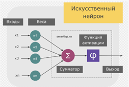
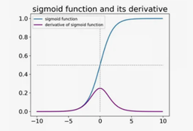
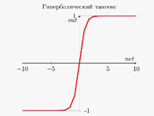

# Функция активации

**Функция активации (activation function)** — нелинейное преобразование, применяемое к выходу искусственного нейрона после вычисления линейной комбинации его входов.
Именно она наделяет нейронную сеть способностью моделировать сложные, нелинейные зависимости.



## Зачем нейрону вообще нужна функция активации
Стандартный ответ что она вносит нелинейность (посмотри на графики стандартных функций активации) в работу нейрона.
Композиция линейных функций — снова линейная функция. Это значит, что глубокая сеть из сотен слоёв без нелинейных активаций математически эквивалентна одному линейному слою. Вся выразительная мощь глубокого обучения исчезает.

Отсюда же вытекают требования к допустимым функциям активации
1.	Нелинейность (для функций активаций скрытых слоёв. На выходном слое, в нашей задачи, мы, поставив функцию активации f(x) = x. Её производная, соответственно будет f`(x) = 1)
2.	Дифференцируемость. В алгоритме нам нужна будет производная функции активации (если кто не знает, то производная это скорость изменения функции в данной конкретной точке) поэтому эта самая производная должна быть.
3.	Нашу функцию активации и её производную должно быть легко посчитать. Потому, что считать придётся очень много раз.
4.	Желательно чтобы производная функции не стремилась к нулю на больших интервалах входных значений.
>Насыщение (производная → 0) — нежелательно для скрытых слоёв, потому что градиент «затухает» и обучение останавливается. Но для выходного слоя насыщение часто не проблема (sigmoid на выходе — стандарт), а для ReLU «нулевая производная при x<0» — это осознанный дизайн (разреженность), а не баг.
5.	Желательна центрированность относительно нуля. Если все выходы положительны (как у сигмоиды или ReLU), градиенты весов следующего слоя будут иметь одинаковый знак, что приводит к зигзагообразной оптимизации и замедляет сходимость. Однако Batch Normalization (это когда обучение проходит не по одному примеру за раз, а сразу на пачке (батче) примеров. Подробнее в следующих главах) часто компенсирует отсутствие центрированности, поэтому требование перестало быть строгим.

Минимальный набор требований — нелинейность, дифференцируемость, вычислительная простота и отсутствие насыщения (чтобы производная не стремилась к нулю. То есть чтобы функция не вырождалась бы в прямую с нулевой скоростью изменения) на большей части области определения

## Перечень функций активации

Опишем обобщённый интерфейс функции
```java
/**Обобщённый интефейс функции*/
public interface FunActivationInterace {
    /**
     * Вычислить значение функции (fun(input) -> output)
     * @param input входной вектор
     * @param output выходной вектор
     */
    void apply(float[] input, float[] output);

    /**
     * Вычислить производную функции (fun`(input) -> deriv)
     * @param input входной вектор
     * @param output выходной вектор вычисленный ранее через apply. Может использоваться для ускорения вычислений
     * @param deriv вектор производных
     */
    void derivative(float[] input, float[] output, float[] deriv);
}
```

### Сигмоида

Сама функция
$$
f(x) = \frac{1}{1 + e^{-x}}
$$
И её производная
$$
f'(x) = \frac{e^{-x}}{(1 + e^{-x})^2} = f(x)(1 - f(x))
$$
так как f(x) мы вычислили во время прямого прохода, то надо его просто запомнить и тогда производную будет вычислить очень легко.

И её график



Так как функция гладкая, от 0 до 1, то её удобно рассматривать как вероятность наступления какого-то события. 
Поэтому используется в основном на выходном слое при бинарной классификации (когда надо дать вероятность того что какой-то объект есть с какой-то вероятностью.

Из минусов что сильно насыщается при больших х (производная стремится к нулю). 
Ну и вычислительная сложность не самая и маленькая.

```java
public class Sigmoid implements FunActivationInterace{
    @Override
    public void apply(float[] input, float[] output) {
        for (int i = 0; i < input.length; i++)
            output[i] = 1.0f / (1.0f + (float) Math.exp(-input[i]));
    }

    @Override
    public void derivative(float[] input, float[] output, float[] deriv) {
        for (int i = 0; i < output.length; i++)
            deriv[i] = output[i] * (1.0f - output[i]);
    }
}
```

## Гиперболический тангес

Сама функция $$f(x) = \tanh(x) = \frac{e^x - e^{-x}}{e^x + e^{-x}} $$
Её производная $$ f'(x) = 1 - \tanh^2(x) $$


Опять же, если мы сделали прямой проход и вычислили tanh(x) то её производная вычисляется просто как 1 – tanh(x)*tanh(x)

Центрирована относительно нуля.\
Из минусов: подвержена насыщению, вычислительная сложность (из-за экспоненты)\
В скрытых слоях тангес почти всегда лучше сигмодиды из-за центрированности относительно нуля. 
Также у него более выраженные градиенты (скорость изменения функции больше) в активной зоне



```java
public class Tanh implements FunActivationInterace {
    @Override
    public void apply(float[] input, float[] out) {
        for (int i = 0; i < input.length; i++) 
            out[i] = (float) Math.tanh(input[i]);
    }

    @Override
    public void derivative(float[] input, float[] out, float[] deriv) {
        for (int i = 0; i < out.length; i++) 
            deriv[i] = 1.0f - out[i] * out[i];
    }
}
```

tanh — это sigmoid, сдвинутая и растянутая: tanh(x) = 2*sigmoid(2x) - 1. 
Она центрирована, и её производная в нуле = 1 (у sigmoid — 0.25). 
Поэтому градиенты в активной зоне в 4 раза больше, и обучение идёт быстрее.

## RELU и похожие на неё

Очень быстро вычисляются.\
Нет насыщения для х > 0 \
И, как следствие, стандартный выбор для скрытых слоёв в свёрточных и полносвязанных сетях.

Классическая Relu\
функция $f(x) = \max(0, x)$\
производная $f'(x) = \begin{cases} 1, & x > 0, \\ 0, & x < 0. \end{cases}$

>Проблема «мёртвых» нейронов. Если ReLU-нейрон получил большой отрицательный градиент и его веса сдвинулись так, что выход всегда < 0, то производная всегда 0, и нейрон перестаёт обучаться навсегда. Это не баг, а следствие формы функции. Именно поэтому появились LeakyReLU, ELU, GELU — они дают ненулевой градиент в отрицательной области.

Leaky Relu\
функция $f(x) = \max(\alpha x, x), \quad \alpha \in (0, 1)$\
производная $f'(x) = \begin{cases} 1, & x > 0, \\ \alpha, & x < 0. \end{cases}$

ELU\
функция $f(x) = \begin{cases} x, & x > 0, \\ \alpha (e^x - 1), & x \leq 0 \end{cases} \quad (\alpha > 0)$ \
производная $f'(x) = \begin{cases} 1, & x > 0, \\ \alpha e^x , & x < 0. \end{cases}$

```java
public class LeakyRelu implements FunActivationInterace{
    private final float alpha;

    /**
     * @param alpha коэффициент наклона для отрицательной полуоси (обычно 0.01)
     */
    LeakyRelu(float alpha) {
        this.alpha = alpha;
    }

    @Override
    public void apply(float[] z, float[] out) {
        for (int i = 0; i < z.length; i++)
            out[i] = z[i] > 0 ? z[i] : alpha * z[i];
    }

    @Override
    public void derivative(float[] z, float[] out, float[] dest) {
        for (int i = 0; i < z.length; i++)
            dest[i] = z[i] > 0 ? 1.0f : alpha;
    }
}
```

## GELU и SiLU (Swish)

Стандарт в трансформерах и диффузионных моделях.

### SiLU / Swish

$$ f(x) = x \cdot \sigma(x) = \frac{x}{1 + e^{-x}} $$

где $\sigma$ — сигмоида. Производная:

$$ f'(x) = \sigma(x) + x \cdot \sigma(x)(1 - \sigma(x)) = \sigma(x)\bigl(1 + x(1 - \sigma(x))\bigr) $$

Свойства: гладкая, не монотонна (немного «ныряет» в отрицательной области), не центрирована. На практике работает чуть лучше ReLU на глубоких сетях, но дороже в вычислении (сигмоида).

```java
public class SiLU implements FunActivationInterface {
    @Override
    public void apply(float[] z, float[] out) {
        for (int i = 0; i < z.length; i++)
            out[i] = z[i] / (1.0f + (float) Math.exp(-z[i]));
    }
    @Override
    public void derivative(float[] z, float[] out, float[] deriv) {
        for (int i = 0; i < z.length; i++) {
            float s = 1.0f / (1.0f + (float) Math.exp(-z[i]));
            deriv[i] = s * (1.0f + z[i] * (1.0f - s));
        }
    }
}
```

### GELU (Gaussian Error Linear Unit)

$$ f(x) = x \cdot \Phi(x) $$

где $\Phi(x)$ — функция распределения стандартного нормального распределения. На практике используют аппроксимацию:

$$ f(x) \approx 0.5x\left(1 + \tanh\left(\sqrt{2/\pi}(x + 0.044715 x^3)\right)\right) $$

Смысл: вместо жёсткого «порога» ReLU GELU **взвешивает** вход на вероятность «быть положительным» по нормальному распределению. Гладкая, не монотонна, стандарт в BERT/GPT.

Производная (для аппроксимации) получается дифференцированием tanh-формулы; 
в коде проще считать её численно.
```java
//численная ароксимаккция тангеса и сигмоиды
    private static float tanh(float x) {
        if (x <= -3f) return -1f;
        if (x >=  3f) return  1f;
        final float x2 = x * x;
        return x * (27f + x2) / (27f + 9f * x2);
    }

    private static float sigmoid(float x) {
        if (x <= -8f) return 0f;
        if (x >=  8f) return 1f;
        return 0.5f + 0.5f * tanh(0.5f * x);
    }

производная tanh: 1 - nk * nk (где nk = tanh(an)) 

производная sigmoid: zk * (1 - zk)
```

Почему GELU, а не ReLU? 
Интуиция: ReLU — «жёсткий порог» (0 или x), GELU — «мягкое взвешивание»: x * Φ(x) — это «x, умноженный на вероятность быть положительным». Гладкость даёт лучшие градиенты.

SiLU — это x * sigmoid(x), GELU — x * Φ(x). Они похожи (обе — «x, умноженный на гладкую функцию от x»), но GELU использует нормальное распределение, SiLU — логистическое. На практике разница мала, но GELU чуть лучше в трансформерах.

## Softmax

[Дополнительно см здесь](../math/Логарифм%20как%20база.md#softmax)

Softmax — это не поэлементная функция активации, как ReLU или Sigmoid. 
ReLU применяется к каждому нейрону независимо: значение на выходе зависит только от входа этого нейрона. 
Softmax же обрабатывает весь вектор выходов слоя целиком: значение для класса i зависит от логитов всех классов. 
Поэтому Softmax нельзя вставить между скрытыми слоями — он имеет смысл только на выходном слое для многоклассовой классификации.

Softmax превращает вектор произвольных чисел (их называют логитами) в вектор вероятностей. 
Она используется в нейросетях для многоклассовой классификации, когда объект нужно отнести ровно к одному из C классов.
(строго в том случае когда объект может принадлежать строго к одному классу, не к нескольким одновременно (в этом случае стандартная сигмоида)).

Пусть на выходе последнего слоя получился вектор [логитов](../math/Логарифм%20как%20база.md#логит) z = (z1, z2, ...., zC).
Это произвольные вещественные числа. Их нельзя напрямую интерпретировать как вероятности: они могут быть отрицательными, не суммируются в единицу, не ограничены сверху.

Softmax превращает логиты в распределение вероятностей: $$ p_i = \frac{e^{z_i}}{\sum_{j=1}^{C} e^{z_j}} $$

Результатом будет вектор p = (p1....pC) где
+ 0 < p_i < 1
+ $ \sum_{i=1}^{C} p_i = 1; $
+ p_i интерпретируется как вероятность того, что объект принадлежит классу i

Применяется, когда объект должен принадлежать ровно одному из C классов. Если объект может принадлежать нескольким классам одновременно (multi-label), Softmax не подходит — там используют независимые Sigmoid на каждый выход.

Как это работает «на пальцах»
Экспонента e^z_i делает все числа положительными и резко усиливает разницу: если один логит чуть больше других, после экспоненты он станет намного больше. Нормировка на сумму превращает результат в доли, которые складываются в 1.

Пример: логиты [2.0, 1.0, 0.1] → экспоненты [7.39, 2.72, 1.11] → сумма 11.22 → вероятности [0.66, 0.24, 0.10]. Класс с логитом 2.0 получил 66% вероятности, хотя превосходил второй класс всего вдвое. Это и есть «усиление разницы».


Производная $ \frac{\partial p_i}{\partial z_j} = p_i (\delta_{ij} - p_j) $
где δ_i — символ Кронекера: 1, если i=j, и 0 иначе.


Почти всегда используется в связке с функцией потерь [categorical-crossentropy](Функция потерь.md#categorical-crossentropy) так как в этом случае
градиент по логитам превращается в простую $ \frac{\partial L}{\partial z_i} = p_i - y_i $

где y_i — истинная метка (one-hot). 
Это одна из причин, почему пара «Softmax + crossentropy» так удобна и популярна

## Шпаргалка по выбору функции активации в скрытых слоях

| Активация | Где стандарт | Стоимость |
|---|---|---|
| ReLU | CNN, MLP | дёшево |
| LeakyReLU | CNN (защита от «мёртвых» нейронов) | дёшево |
| SiLU/Swish | современные CNN, EfficientNet | средне |
| GELU | трансформеры (BERT, GPT) | дорого |
| Tanh | RNN | средне |
| Sigmoid | выход бинарной классификации | средне |
| Softmax | выход многоклассовой классификации | средне |