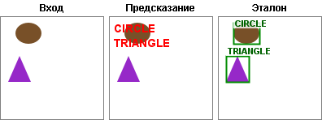
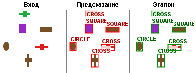
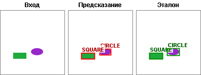
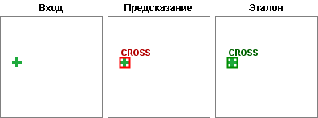
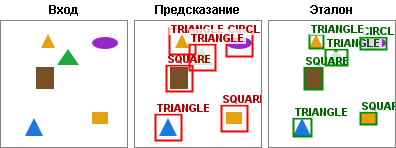
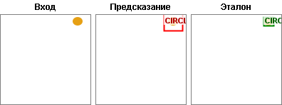
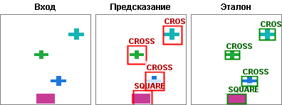
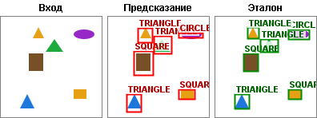
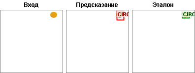
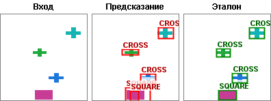

# Глава 1. CNN сети

Convolutional Neural Networks, свёрточные нейронные сети.

CNN — это тип глубоких нейросетей, который особенно хорош для работы с данными, имеющими пространственную структуру: изображениями, видео, иногда даже спектрограммами звука.
Сеть умеет выделять локальные паттерны (края, углы, текстуры) и собирать их в более сложные образы (глаза, колёса, лица).

## Что такое CNN

Мы уже работали с распознаванием изображений ([задача MNIST](../mlp/tasks/Задачи.md#задача-mnist)).
Но что делать если размеры картинки много больше, чем 28 на 28 пикселей (а это уже, на минутку, 784 нерона во входном слое)?
Что делать если картинка цветная – размерность возрастает сразу в три раза (по числу RGB цветных каналов)?
Или если картинка очень большая и надо найти на ней, допустим, все двери или все лица или ещё какие-то объекты, которые могут быть большими, на переднем плане, или маленькими, на заднем плане?

И это ещё не самая большая беда.
Хуже то, что MLP теряет пространственную структуру: для него пиксель (0,0) и пиксель (255,255) — просто «признак №0» и «признак №196607».
Сдвиньте объект на 3 пикселя — и для MLP это уже совсем другой входной вектор, хотя семантически изображение почти не изменилось.
MLP не знает, что соседние пиксели связаны, и не умеет переиспользовать знание о паттерне в разных местах картинки.

Что делать? – сменить тип нейронной сети с MLP на CNN.

Именно эти две проблемы — взрывное число параметров и отсутствие инвариантности к сдвигу — решает свёрточная сеть.

Свёрточная сеть — это одно или несколько «окошек», скользящих по изображению и ищущих свои паттерны.
Из этого следуют два принципа:
- Локальное восприятие: нейрон смотрит не на всё изображение, а лишь на маленький участок.
- Разделяемые веса: один и тот же фильтр (набор весов) применяется ко всему изображению, выискивая свой уникальный паттерн в любом месте.

Сёртка это

$$
y[i, j, oc] = b[oc] + \sum_{ic} \sum_{kh} \sum_{kw} W[oc, ic, kh, kw] \cdot x[ic,\ i \cdot \text{stride} + kh - \text{padding},\ j \cdot \text{stride} + kw - \text{padding}]
$$

где oc — выходной канал (номер фильтра), ic — входной канал, (kh, kw) — позиция в ядре.
Обратите внимание: одни и те же W[oc, ic, :, :] используются для всех (i, j) — это и есть разделяемые веса (weight sharing).

>«Если индекс `i·stride + kh - padding` выходит за пределы изображения, x[...] считается равным 0 — это и есть padding. В коде это реализовано проверкой `if (idx >= 0 && idx < size)` внутри цикла.

Сила CNN — в умении автоматически строить иерархию пространственных признаков, инвариантную к их положению: от простых граней к сложным концептуальным деталям.

## Из чего состоит CNN

---

**Свёрточный слой (Convolutional Layer) — сердце CNN.**
- Фильтр (ядро) — маленькая матрица весов, например 3×3 или 5×5.
- Фильтр накладывается на левый верхний угол изображения, вычисляется поэлементное произведение и сумма. Получается одно число.
- Затем фильтр сдвигается на шаг (stride) и операция повторяется.
- Результат — карта признаков (feature map). Каждый фильтр учится реагировать на свой узор: горизонтальную линию, угол, переход цвета.
- Первые слои находят простые грани, средние — текстуры и части объектов, глубокие — целые объекты (глаза, колёса).

[ConvLayer](../../code/simple/net/layers/cnn/ConvLayer.java) - Свёрточный слой (2D) <b>без активации</b>: {@code z = W * x + b}.

```java
//Конструктор
new ConvLayer.Dto(
    outChannels,   // число выходных каналов (фильтров)
    kernelSize,    // размер квадратного ядра (3, 5, ...)
    stride,        // шаг свёртки (обычно 1)
    padding        // дополнение нулями (обычно (kernelSize-1)/2)
)
```

```text
Форма выхода
outH = (inH + 2·padding - kernelSize) / stride + 1
outW = (inW + 2·padding - kernelSize) / stride + 1
outShape = cnn(outChannels, outH, outW)
```

Параметры
- weights[oc][ic][kh][kw] — ядро свёртки;
- biases[oc] — смещение выходного канала;

---

**Padding (паддинг) — дополнение картинки по краям нулями**

Дополнение картинки по краям нулями, чтобы не терять информацию с края и контролировать размер выхода.
Без padding'а каждый свёрточный слой «съедает» (k - 1) пикселей по каждой оси;
с padding = (k - 1) / 2 при stride = 1 размер сохраняется.

Padding есть у ConvLayer, именно там он реализован — это поле padding в ConvLayer.Dto.

---

**Pooling (пулинг) — уменьшение размерности.**

Берём квадрат 2×2 и выбираем максимальное значение (MaxPool).
Бывает и усредняющий (AvgPool, в этой библиотеке не реализован).

Pooling не обучается — у него нет весов; он только прореживает карту признаков, снижая число параметров и добавляя инвариантность к небольшим сдвигам.

[MaxPoolLayer](../../../../code/net/layers/cnn/MaxPoolLayer.java)

```java
new MaxPoolLayer.Dto(poolSize, stride)
```

```text
Форма выхода

outH = (inH - poolSize) / stride + 1
outW = (inW - poolSize) / stride + 1
```

Градиент идёт только в позицию максимума (сохранённые в argmax последнего forward).
Если argmax == -1 — это баг в коде: MaxPool всегда должен найти максимум (окно никогда не пустое, если outH/outW вычислены верно). Если вы видите -1 — проверьте формулы outH/outW и границы окна.

---

**Upsample — операция, обратная пулингу(увеличение размерности)**

Увеличение размерности (nearest-neighbor в UpsampleLayer).
Нужна в архитектурах типа autoencoder/segmentation/decoder, где надо вернуться к исходному разрешению.

[UpsampleLayer](../../../../code/net/layers/cnn/UpsampleLayer.java)

```java
new UpsampleLayer.Dto(scale)   // scale >= 1
```

Nearest-neighbor: каждый элемент входа копируется в блок scale × scale выхода.

Градиент суммируется по блоку scale × scale, соответствующему одному входному элементу. Это транспонированная операция к forward (forward размножает, backward складывает).

---

**Flatten (выпрямитель)***

Cлой, превращающий многомерный тензор в одномерный (ReshapeLayer.FlattenLayer).
Обычно он вообще ничего не делает, просто изменяет форму тензора.

Реализован в общем виде как "изменитель формы".
[ReshapeLayer](../../../../code/net/layers/structure/ReshapeLayer.java)

---

[Нормализация](../base/term/Регуляризация.md#batch-normalization)

В CNN чаще всего используют BatchNorm (в этой библиотеке не реализован).
Но [InstanceNorm](../../../../code/net/layers/core/InstanceNormLayer.java) — стандарт для style transfer и генеративных CNN.

Instance Normalization (InstanceNorm) — нормировка, которая для каждого канала каждого примера отдельно считает среднее и дисперсию по пространственным осям и применяет обучаемые gamma/beta (общие для всех примеров).

Стандарт для style transfer (Fast Neural Style, AdaIN) и генеративных CNN. Причина: в style transfer «стиль» — это статистики активаций (mean/var по каналам), и их нужно нормировать на каждый пример отдельно, чтобы стиль одного изображения не «протекал» в другое.

---

[Регуляризация](../base/term/Регуляризация.md#dropout)

CNN склонны к переобучению не меньше MLP. Им требуется регулязация.

[DropoutLayer](../../../../code/net/layers/core/DropoutLayer.java).

В CNN dropout ставят либо после pooling/flatten перед dense-головой, либо (реже) как spatial dropout между свёртками.

Не ставить после MaxPool: MaxPool уже выбрасывает информацию, а Dropout после него дополнительно «разреживает» и без того прореженную карту. Эффект слабый, а сигнал портится.

DropoutLayer: что он делает
- во время обучения (training = true) с вероятностью p элемент «выключается» (выход 0), а выжившие масштабируются на 1/(1-p), чтобы матожидание выхода совпало со входом;
- во время инференса (training = false) слой — тождественный: y = x.

```text
Forward:
    mask[i] ~ Bernoulli(1 - p)
    y[i]    = x[i] · mask[i] / (1 - p)     // training
    y[i]    = x[i]                         // inference
    
Backward (умножает deltaNext на ту же маску):
    deltaPrev[i] = deltaNext[i] · mask[i] / (1 - p)    
```

## Алгоритм CNN

картинка → [Conv → ReLU → Pool] × N → Flatten → Dense → класс

```text
Свёртка (Conv2d):
Маленький фильтр, например 3×3, скользит по изображению.
На каждом шаге он умножает свои веса на кусочек картинки и суммирует → одно число.
Много фильтров → много карт признаков.
```

```text
Пулинг (MaxPool):
Берём окно, например 2×2, и оставляем максимум.
Картинка уменьшается, но главное сохраняется.
```

В этой библиотеке ConvLayer — без активации (z = W*x + b).
Активация — отдельный слой ActivationLayer. Поэтому в графе свёртка и ReLU — два узла, а не один:
```java
h = b.layer(new ConvLayer.Dto(32, 3, 1, 1), x);   // свёртка
h = b.layer(new ActivationLayer.Dto(new LeakyRelu()), h);  // активация
```

Это осознанное решение: так слой остаётся «чистым» (только линейная операция + веса), а активация переиспользуется и легко заменяется.

## Решение задач

### Решение задачи распознавания рукописных цифр mnist

[Описание задачи](../code/Задачи%20которые%20мы%20будем%20решать.md#задача-mnist)

[Код](../code/task/Mnist.java)

Прежде мы [решали](../flows/main/mlp/Глава%204.%20Практика.%20Решаем%20задачи%20mlp-сетями.md#задача-распознавания-рукописных-цифр-mnist) эту задачу mlp-сетью.
Здесь мы начали с Accuracy=0.9637 и пришли к Accuracy=0.9807 на 6-ой эпохе обучения примерно за 7 минут

CNN сразу даёт высокую accuracy, потому что свёртки уже на первом слое извлекают края и углы — а цифры состоят именно из краёв и углов.
MLP должен выучить эти паттерны сам — через 784 входов, что дольше.
Это не «магия», а следствие индуктивного смещения (inductive bias): CNN знает, что соседние пиксели связаны, и использует это с первого шага.
>Индуктивное смещение (inductive bias) — это набор предположений, которые модель делает о данных до того, как увидит хотя бы один пример. Это «предвзятость» в хорошем смысле: не «предубеждение», а априорное знание о структуре задачи, которое сужает пространство гипотез и помогает учиться быстрее и на меньших данных.
>
> Представьте, что вам нужно угадать закономерность по трём точкам: (1, 2), (2, 4), (3, 6).
>
> Без индуктивного смещения возможных функций — бесконечно много: y = 2x, y = 2x + sin(πx), y = 2x + 1000·(x-1)(x-2)(x-3), и т.д. Все проходят через эти три точки, но ведут себя по-разному между ними.
>
> С индуктивным смещением «функция гладкая и простая» — вы выберете y = 2x, потому что это самое простое объяснение. Это смещение помогло выбрать правильную гипотезу из бесконечного множества.

Разные архитектуры имеют разные индуктивные смещения:

| Архитектура | Индуктивное смещение | Что это значит на практике |
| --- | --- | --- |
| MLP | «Все входы независимы» | Не знает, что соседние пиксели связаны; должен выучить это сам |
| CNN | «Соседние пиксели связаны; паттерн может быть в любом месте» | Свёртка ищет локальные паттерны; разделяемые веса дают инвариантность к сдвигу |
| RNN | «Порядок важен; одни и те же веса на всех шагах» | Обрабатывает последовательности с памятью о прошлом |
| Трансформер | «Любые элементы могут быть связаны; внимание учится само» | Гибче CNN, но требует больше данных |

>CNN «знает» заранее, что:
>- Локальность: соседние пиксели важнее дальних (свёртка смотрит на маленькое окно).
>- Инвариантность к сдвигу: один и тот же паттерн (край, угол) может быть в любом месте картинки (разделяемые веса).
>
> MLP этого не знает: для него пиксель (0,0) и (255,255) — просто «признак №0» и «признак №196607». Он должен выучить локальность и инвариантность из данных — а это требует гораздо больше примеров.
>
> Отсюда и «0.98 с первого шага» у CNN: свёртки уже на первом слое извлекают края и углы, потому что архитектура «подталкивает» их к этому. MLP должен «догадаться» сам, что края важны, — и на это уходит больше эпох.
>
> Индуктивное смещение — не всегда хорошо. Если смещение не соответствует задаче, модель будет учиться плохо:
> - CNN на табличных данных (где нет пространственной структуры) — плохая идея: свёртка ищет локальные паттерны, которых там нет.
> - MLP на изображениях — работает, но требует гораздо больше данных и параметров.
> - RNN на множествах (где порядка нет) — плохо: порядок — ложное смещение.
>
> индуктивное смещение должно соответствовать структуре задачи. CNN — для изображений, RNN — для последовательностей, MLP — для таблиц (или когда структура неизвестна).


Но теперь уже cnn-сетью
```java
        log.info("cnn_seq");
        Sequence.of(List.of(
                //вход - картинка 28 × 28 = 784 пикселя
                new Sequence.InputDto(TensorShape.cnn(1, 28, 28)),

                // 1-й свёрточный блок: 1×28×28 → 32×28×28 → 32×14×14
                new ConvLayer.Dto(32, 3, 1, 1), new ActivationLayer.Dto(new LeakyRelu()),
                new MaxPoolLayer.Dto(2, 2),

                // 2-й свёрточный блок: 32×14×14 → 64×14×14 → 64×7×7
                new ConvLayer.Dto(64, 3, 1, 1), new ActivationLayer.Dto(new LeakyRelu()),
                new MaxPoolLayer.Dto(2, 2),

                // Голова: flatten → dense → dropout → логиты
                new ReshapeLayer.FlattenLayer.Dto(),                      // flat(64*7*7) = flat(3136)
                new DenseLayer.Dto(128), new ActivationLayer.Dto(new LeakyRelu()),
                new DropoutLayer.Dto(0.3f),                               // регуляризация
                new DenseLayer.Dto(10)                                    // логиты
        )).train(
                30,
                dataset,
                new SoftmaxCrossEntropy(),                                // лосс для one-hot
                new AdamW(0.001f),                                        // адаптивный LR
                64,                                                       // батч
                10,
                List.of(new Accuracy()),
                m -> m.get(0).result() > 0.99f,                           // early stop (CNN точнее MLP)
                -1f
        );
```

```terminaloutput
22:06:54.450 [main] INFO rawnet.code.sequence.model.net.Sequence -- Эпоха обучения 0. Метрики Метрики: Accuracy=0.9820  
22:09:40.289 [main] INFO rawnet.code.sequence.model.net.Sequence -- Эпоха обучения 1. Метрики Метрики: Accuracy=0.9896  
22:12:33.232 [main] INFO rawnet.code.sequence.model.net.Sequence -- Эпоха обучения 2. Метрики Метрики: Accuracy=0.9902  
22:12:33.234 [main] INFO rawnet.code.sequence.model.net.Sequence -- ответ сети [-0.17, -0.43, -1.32, 3.04, -2.58, -3.70, -5.60, 16.11, -5.51, 3.50]  (правильный ответ = [0.00, 0.00, 0.00, 0.00, 0.00, 0.00, 0.00, 1.00, 0.00, 0.00])
22:12:33.235 [main] INFO rawnet.code.sequence.model.net.Sequence -- ответ сети [4.01, 4.49, 19.01, -6.10, -5.75, -10.64, 1.52, -5.67, -1.02, -4.28]  (правильный ответ = [0.00, 0.00, 1.00, 0.00, 0.00, 0.00, 0.00, 0.00, 0.00, 0.00])
22:12:33.237 [main] INFO rawnet.code.sequence.model.net.Sequence -- ответ сети [-3.77, 11.48, -1.57, -6.44, 1.01, -3.64, -1.32, -0.85, -1.39, -1.58]  (правильный ответ = [0.00, 1.00, 0.00, 0.00, 0.00, 0.00, 0.00, 0.00, 0.00, 0.00])
```

Как видите - каждая эпоха выполняется заметно дольше (чуть меньше 3 минут против 20-и секунд у мниста).
Зато мы сразу начали с качества Accuracy=0.9820 после первой эпохи и пришли к Accuracy=0.9902  уже на 3-ьем шаге

Можно ли ускорить?
Можно. Например уменьшить число каналов и нейронов в денсе-слое.
Но это удлинит обучение(будет больше шагов) и выйдет практически баш на баш.

### Решение задачи детекции объектов

[Описание задачи](tasks/Задачи.md#задача-детекции-объектов)

[ImageDetectDemo/runDetection](tasks/imageDetect/ImageDetectDemo.java)

Постановка. На вход подаётся изображение, на выходе — вектор из C чисел, по одному на каждый класс объектов.
Значение 1 означает «объект этого класса на картинке присутствует», 0 — «отсутствует».
Геометрия (где именно находится объект) не предсказывается — только факт присутствия.

Это ближайший аналог обычной классификации, только классов может быть несколько одновременно.
Если в задаче классификации выход — softmax над C классами (ровно один правильный), то здесь выход — C независимых sigmoid-вероятностей (каждый класс — свой бинарный классификатор).
Это и есть multi-label.

Как решается
- Архитектура. Стандартная CNN: несколько блоков «свёртка → активация → пулинг» сжимают изображение в карту признаков, затем Flatten и полносвязная голова выдают C логитов.
- Последний слой — Sigmoid, чтобы каждое число стало вероятностью в (0, 1).


Функция потерь. Бинарная кросс-энтропия (BCE), усреднённая по C выходам:
```text
L = -(1/C) · Σ_c [ t_c · log(p_c) + (1 - t_c) · log(1 - p_c) ]

где 
    t_c ∈ {0, 1} — эталон, 
    p_c ∈ (0, 1) — предсказание после sigmoid. 

В паре Sigmoid + BCE градиент по логиту упрощается до p_c - t_c, что даёт стабильное обучение.
```

```java
    private static Sequence buildDetectionModel() {
    return Sequence.of(List.of(
            new Sequence.InputDto(TensorShape.cnn(3, SIZE, SIZE)),

            new ConvLayer.Dto(16, 3, 1, 1),
            new ActivationLayer.Dto(new LeakyRelu(0.1f)),
            new MaxPoolLayer.Dto(2, 2),

            new ConvLayer.Dto(32, 3, 1, 1),
            new ActivationLayer.Dto(new LeakyRelu(0.1f)),
            new MaxPoolLayer.Dto(2, 2),

            new ConvLayer.Dto(64, 3, 1, 1),
            new ActivationLayer.Dto(new LeakyRelu(0.1f)),
            new MaxPoolLayer.Dto(2, 2),

            new ReshapeLayer.FlattenLayer.Dto(),
            new DenseLayer.Dto(TensorShape.flat(128)),
            new ActivationLayer.Dto(new LeakyRelu(0.1f)),
            new DropoutLayer.Dto(0.3f),
            new DenseLayer.Dto(TensorShape.flat(ImageDatasetGenerator.NUM_CLASSES)),
            new ActivationLayer.Dto(new Sigmoid())
    ));
}

        Sequence model = loadOrTrain(
        gen, ImageDatasetGenerator.Task.DETECTION, modelPath,
        /*trainCount=*/3000,
        ImageDetectDemo::buildDetectionModel,
        ds -> new BinaryCrossEntropy(),
        50,
        Model.earlyStop(3, 0.005f, log),
        loss -> List.of(
                new LossMetric(loss),
                new Accuracy(0.5f),
                new Precision(0.5f),
                new Recall(0.5f),
                new F1(0.5f)),
        5e-4f
);
```

MaxPool после каждой свёртки — снижает разрешение, растит рецептивное поле. 3 пула → 128/8 = 16

Dropout перед последним слоем — стандарт.

Первый прогон - сеть не училась. Почему?

Почему первый прогон стоял на месте.
При MAX_OBJECTS=8, MIN_SHAPE=5, MAX_SHAPE=13 на 128×128 почти на каждой картинке есть все 4 класса.
Target — [1,1,1,1] в 95% случаев (классическая ловушка вырожденных данных: если 95% примеров — положительные, BCE учит константу p≈0.5, потому что она минимизирует loss на большинстве примеров. Градиент от редких отрицательных «тонет».).
Сеть выучивает константу p≈0.5 (loss 0.53), и градиент от редких «0» тонет в градиенте от частых «1».
>Почему p≈0.5? Потому что BCE при константном p=0.5 даёт loss = 0.693 (log(2)), а градиент — 0 (p - t = 0.5 - 1 = -0.5, но усредняется по всем примерам, и для 95% он почти 0, а для 5% — большой, но редкий). Сеть «застревает» в локальном минимуме.

Лечение:
- сделать данные разнообразнее (крупнее фигуры, 10% пустых, перекос к n=1..2),
- уменьшить LR до 5e-4.

>Почему LR = 5e-4 помогает? Потому что меньший lr даёт больше шагов в редких примерах до того, как сеть «убежит» в константу. Это не «лечение» причины, а обход её.
>
> Настоящее лечение — балансировка классов (BCE с весами), focal loss, или изменение данных (что мы и сделали).

После этого loss падает 0.63 → 0.25, Accuracy 0.18 → 0.76.

Это классическая ловушка **вырожденных данных** (почти всегда все 4 класса на картинке) ломает обучение, и как изменение генератора (крупнее фигуры, больше пустых, перекос к малым n) + LR (5e-4) это лечит.

После сделанных изменений, видим лог прогона -  сеть выучилась.

```terminaloutput
12:12:41.426 [main] INFO rawnet.code.sequence.model.net.Sequence -- Эпоха обучения 0. Метрики Метрики: Loss(BinaryCrossEntropy)=0.6297  Accuracy=0.2833  Precision(macro)=0.2846  Recall(macro)=0.2972  F1(macro)=0.3037  
...
12:27:35.804 [main] INFO rawnet.code.sequence.model.net.Sequence -- Эпоха обучения 17. Метрики Метрики: Loss(BinaryCrossEntropy)=0.2686  Accuracy=0.7600  Precision(macro)=0.7520  Recall(macro)=0.7986  F1(macro)=0.7551  
12:27:35.804 [main] INFO rawnet.docs.flows.main.cnn.tasks.imageDetect.ImageDetectDemo -- [early stop] best=0.2515 -> current=0.2686 (+0.0171), 3 эпох без улучшения (>0.5000%)
12:27:35.814 [main] INFO rawnet.code.sequence.model.net.Sequence -- ответ сети [1.00, 0.00, 0.00, 0.00]  (правильный ответ = [1.00, 0.00, 0.00, 0.00])
12:27:35.822 [main] INFO rawnet.code.sequence.model.net.Sequence -- ответ сети [0.69, 1.00, 0.01, 0.00]  (правильный ответ = [1.00, 1.00, 0.00, 0.00])
12:27:35.830 [main] INFO rawnet.code.sequence.model.net.Sequence -- ответ сети [0.00, 0.33, 1.00, 0.00]  (правильный ответ = [0.00, 0.00, 1.00, 0.00])
12:27:35.838 [main] INFO rawnet.code.sequence.model.net.Sequence -- ответ сети [0.00, 0.21, 0.11, 0.00]  (правильный ответ = [0.00, 1.00, 0.00, 0.00])
12:27:35.847 [main] INFO rawnet.code.sequence.model.net.Sequence -- ответ сети [0.04, 0.00, 0.94, 0.00]  (правильный ответ = [0.00, 0.00, 1.00, 0.00])
```



### Решение задачи определения объектов

[Описание](tasks/Задачи.md#задача-определения-объектов)

На вход — изображение.
На выходе — набор объектов, для каждого: класс (CIRCLE/SQUARE/CROSS/TRIANGLE) и ограничивающий прямоугольник (cx, cy, w, h).
В отличие от простой детекции, здесь нужно ответить не только «что есть», но и «где именно», причём раздельно для каждого объекта (два круга — это два объекта, а не один класс «круг»).

Три подхода к решению. Испробуем их все.

### Семантическая сегментация
«Что за класс у каждого пикселя?»

U-Net

Семантическая сегментация решает задачу попиксельной классификации.
Нейросеть для каждого пикселя изображения предсказывает класс объекта, к которому он принадлежит (машина, дорога, человек, фон).

- Приоритет: Локализация. Сначала определяется, где находится объект, а затем — что это за объект.
- Результат: Карта сегментации, где каждый пиксель раскрашен в цвет своего класса.
- Ограничение для детекции: Этот подход не разделяет объекты одного класса. Если на изображении две машины стоят вплотную, сегментационная карта покажет одну общую область класса «машина», а не два отдельных объекта.

Уточнение задачи.
На вход — картинка S×S.
На выходе — маска S×S, где каждый пиксель отнесён к одному из C классов (или к фону).
4-е класса фигур (CIRCLE, SQUARE, CROSS, TRIANGLE), фон = «все каналы нули» в one-hot.
Формат targets — flat(C·S·S), раскладка [class0(S·S), class1(S·S), ...], каждый пиксель — one-hot.

Формат разметки для семантической сегментации.
Выход сети — плоский вектор длины C·H·W, где C = SEG_CLASSES — число классов, включая фон (у вас C = 5: фон, CIRCLE, SQUARE, CROSS, TRIANGLE).
Для пикселя pix его one-hot лежит «столбиком» по каналам: t[c·H·W + pix] = 1, если пиксель принадлежит классу c, иначе 0.
В каждом пикселе ровно одна единица: Σ_c t[c·H·W + pix] = 1. Фон — это класс 0.

Подготовим датасет:
он должен будет возвращать плоский [one-hot вектор](../../../base/term/Функция%20потерь.md#one-hot-вектор) длины SEG_CLASSES * H * W.
Где SEG_CLASSES - количество классов фигур. H и W - высота и ширина картинки.
То есть на каждый пиксель приходится SEG_CLASSES = 5 чисел, а не одно.
```text
n = H·W

индексы:   [0 .. n-1]        [n .. 2n-1]        [2n .. 3n-1]   ...   [4n .. 5n-1]
канал:      фон (класс 0)     CIRCLE (класс 1)   SQUARE         ...   TRIANGLE (класс 4)
пиксель:    0, 1, ..., n-1    0, 1, ..., n-1     ...

Для пикселя pix one-hot лежит «столбиком»:
t[0·n + pix], t[1·n + pix], t[2·n + pix], t[3·n + pix], t[4·n + pix]

Пример: пиксель pix попал внутрь круга.
t[0·n + pix] = 0   — не фон
t[1·n + pix] = 1   — CIRCLE
t[2·n + pix] = 0,  t[3·n + pix] = 0,  t[4·n + pix] = 0
```

Почему не одна цифра на пиксель?
Потому что на выходе сети — непрерывные числа (вероятности), а функция потерь должна быть дифференцируемой.
Класс-как-число (0, 1, 2, 3, 4) — это регрессионная цель, где класс 4 «в 4 раза больше» класса 1.
Для категорий это бессмысленно. Поэтому используют one-hot: по каждому классу независимая бинарная задача «этот пиксель принадлежит классу c?».

В текущей реализации пересечения не обрабатываются — работает правило «последний победил».
В реальной семантической сегментации пересечения — фундаментальная проблема, потому что задача по определению не различает экземпляры.

[Описание задачи](tasks/Задачи.md#семантическая-сегментация)

[ImageDetectDemo/runSemseg](tasks/imageDetect/ImageDetectDemo.java)


```java
    private static Sequence buildSemsegModel(int numClasses, int outSize) {
    return Sequence.of(List.of(
            new Sequence.InputDto(TensorShape.cnn(3, SIZE, SIZE)),

            // энкодер: 128 → 64 → 32
            new ConvLayer.Dto(16, 3, 1, 1),
            new ActivationLayer.Dto(new LeakyRelu(0.1f)),
            new MaxPoolLayer.Dto(2, 2),

            new ConvLayer.Dto(32, 3, 1, 1),
            new ActivationLayer.Dto(new LeakyRelu(0.1f)),
            new MaxPoolLayer.Dto(2, 2),

            new ConvLayer.Dto(64, 3, 1, 1),
            new ActivationLayer.Dto(new LeakyRelu(0.1f)),
            new ConvLayer.Dto(64, 3, 1, 1),
            new ActivationLayer.Dto(new LeakyRelu(0.1f)),

            // декодер: 32 → 64 → 128
            new UpsampleLayer.Dto(2),
            new ConvLayer.Dto(32, 3, 1, 1),
            new ActivationLayer.Dto(new LeakyRelu(0.1f)),
            new UpsampleLayer.Dto(2),
            new ConvLayer.Dto(16, 3, 1, 1),
            new ActivationLayer.Dto(new LeakyRelu(0.1f)),

            // голова: C каналов на пиксель
            new ConvLayer.Dto(numClasses, 1, 1, 0),
            new ReshapeLayer.Dto(TensorShape.flat(outSize))
    ));
}

        Sequence model = loadOrTrain(
        gen, ImageDatasetGenerator.Task.SEMSEG, modelPath,
        /*trainCount=*/1500,
        () -> buildSemsegModel(numClasses, outSize),
        /*lossFactory=*/ds -> new SegLoss(SIZE, numClasses),
        /*maxEpoch=*/30,
        /*earlyStop=*/Model.earlyStop(2, 0.01f, log),
        /*metricsFactory=*/loss -> List.of(new LossMetric(loss)),
        1e-3f
);
```

Почему отдельная [SegLoss](tasks/imageDetect/loss/SegLoss.java)

Стандартные функции потерь фреймворка решают другие задачи:
- SoftmaxCrossEntropy — multiclass на один вектор: один softmax на весь выход, Σ p_i = 1 по всем C элементам. Для сегментации нужно C softmax'ов — по одному на пиксель, каждый по своим C каналам. Если подать flat(C·S·S) в SoftmaxCrossEntropy, он сделает один softmax по 81920 числам, а не 16384 softmax'ов по 5. Это неверная задача.
- BinaryCrossEntropy — C независимых бинарных классификаторов. Формально применима (one-hot — валидные бинарные метки), но: (а) не учитывает, что в пикселе ровно один класс — градиент «распыляется»; (б) нет нормировки на «сумма вероятностей = 1», сходимость медленнее; (в) для C=5 это 5 BCE на пиксель вместо одного CE — в C раз больше вычислений и в C раз «мягче» сигнал.
- Mse/Mae — регрессия, не подходит для категорий.

SegLoss делает именно то, что нужно: softmax по каналам в каждом пикселе + CE, усреднённый по пикселям.
Формула:
```text
для пикселя i:
  z_c = logits[c·n + i]                    (c = 0..C-1)
  p_c = softmax(z)_c
  L_i = -Σ_c t[c·n + i] · log(p_c)

L = (1/n) · Σ_i L_i
dL/dz_c = (p_c - t[c·n + i]) / n n = S·S — число пикселей, а не число элементов
```

Семантическая сегментация — лучший выбор, когда важна форма объекта (медицина, автономное вождение, маски), и худший, когда нужно разделить объекты одного класса (там нужен heatmap или instance segmentation).

```terminaloutput
10:08:42.700 [main] INFO rawnet.docs.code.task.SegDemo -- Датасет: train=1200, test=300
10:10:20.678 [main] INFO rawnet.code.sequence.model.net.Sequence -- Эпоха обучения 0. Метрики Метрики: Loss(SegLoss)=0.1252  
10:12:02.678 [main] INFO rawnet.code.sequence.model.net.Sequence -- Эпоха обучения 1. Метрики Метрики: Loss(SegLoss)=0.0941  
10:13:39.499 [main] INFO rawnet.code.sequence.model.net.Sequence -- Эпоха обучения 2. Метрики Метрики: Loss(SegLoss)=0.0539  
...
10:59:05.031 [main] INFO rawnet.code.sequence.model.net.Sequence -- Эпоха обучения 30. Метрики Метрики: Loss(SegLoss)=0.0049  
```

Результаты\
\
\


## Heatmap-подход
«Где находится центр объекта?»

CenterNet-style

Объект представляется одной точкой — его центром.
Сеть предсказывает не список координат, а карту вероятностей той же формы, что и вход.
Пики (локальные максимумы) этой карты — центры объектов.

Ключевое отличие от сегментации — в сегментации вся площадь круга даёт CIRCLE = 1, а в heatmap CIRCLE ≈ 1 только в окрестности центра, с плавным спадом по гауссиане.
Вся остальная площадь объекта (и фон) даёт 0 по всем каналам.
```text
n = W * H

индексы:   [0 .. n-1]          [n .. 2n-1]          [2n .. 3n-1]   [3n .. 4n-1]
канал:      CIRCLE (класс 0)   SQUARE (класс 1)     TRIANGLE       CROSS (класс 3)
пиксель:    0, 1, 2, ..., n-1  0, 1, 2, ..., n-1    ...            ...
```

Для пикселя pix значения по каналам лежат «столбиком»: t[0*n + pix], t[1*n + pix], t[2*n + pix], t[3*n + pix].

Пример. Пиксель pix — центр круга:
```text
t[0*n + pix] ≈ 1   — это центр CIRCLE
t[1*n + pix] = 0   — не квадрат
t[2*n + pix] = 0   — не треугольник
t[3*n + pix] = 0   — не крест
```

Пример. Пиксель pix — край круга, 10 пикселей от центра, σ = 5:
```text
t[0*n + pix] = exp(-100 / (2·25)) ≈ 0.135   — уже не 1, но и не 0
остальные каналы = 0
```

Вокруг центра — гауссов «колокол». Формально для каждого объекта с центром (cx, cy) и классом c:
```
t[c*n + y*W + x] = max( t[c*n + y*W + x], exp(-((x-cx)² + (y-cy)²) / (2σ²)) )
```

Почему Focal Loss, а не BCE
Дисбаланс классов катастрофический: ~99% пикселей — фон с t = 0. Обычная BCE доминируется фоном: сеть быстро учится «везде 0», получает низкий loss и не видит пиков. Градиент от фона «забивает» градиент от центров.

[Focal Loss](../../../base/term/Функция%20потерь.md#focal-loss-бинарная) гасит вклад «лёгких» (уверенно правильных) пикселей множителем (1 - p_t)^γ:
```text
FL(p_t) = -α_t · (1 - p_t)^γ · log(p_t)

где  p_t = p·t + (1-p)·(1-t)          // p, если t=1; 1-p, если t=0
     α_t = α·t + (1-α)·(1-t)          // α, если t=1; 1-α, если t=0
```

[HeatmapLoss](tasks/imageDetect/loss/HeatmapLoss.java) — Focal Loss поверх сигмоиды

[Описание задачи](tasks/Задачи.md#heatmap-подход)

[ImageDetectDemo/runHeatmap](tasks/imageDetect/ImageDetectDemo.java)


Heatmap-детекция — это плотное предсказание (dense prediction): выход имеет пространственную структуру C × S × S, а не плоский вектор.
Классическая схема для таких задач — энкодер-декодер (U-Net-подобная):
```text
вход S×S
  ↓ энкодер: Conv + Pool, разрешение падает, каналы растут
  ↓ бутылочное горлышко: глубокие Conv на малом разрешении
  ↓ декодер: Upsample + Conv, разрешение растёт
  ↓ голова: Conv 1×1 на C каналов
выход C×S×S
```

Зачем сжимать.

На полном разрешении 128×128 Conv(64, 64, 3, 1) стоит 64·64·9·128·128 ≈ 6·10⁸ MAC на пример — дорого.
На 32×32 тот же слой в 16 раз дешевле, но даёт большое рецептивное поле: один нейрон видит ~60×60 исходных пикселей, что важно для контекста (где объект относительно других).

Зачем разжимать.

Центры объектов нужно локализовать точно (в пикселях). На 32×32 один пиксель = 4×4 исходных — грубо.
Декодер возвращает разрешение, чтобы heatmap была 128×128 и декодер находил центры с точностью ±1 px.

Каждый блок энкодера:
```text
Conv(C, 3, 1, 1) → LeakyRelu → MaxPool(2, 2)
```

```java
    private static Sequence buildHeatmapModel(int numClasses, int outSize) {
    return Sequence.of(List.of(
            new Sequence.InputDto(TensorShape.cnn(3, SIZE, SIZE)),

            // энкодер: 128 → 64 → 32
            new ConvLayer.Dto(16, 3, 1, 1),
            new ActivationLayer.Dto(new LeakyRelu(0.1f)),
            new MaxPoolLayer.Dto(2, 2),

            new ConvLayer.Dto(32, 3, 1, 1),
            new ActivationLayer.Dto(new LeakyRelu(0.1f)),
            new MaxPoolLayer.Dto(2, 2),

            new ConvLayer.Dto(64, 3, 1, 1),
            new ActivationLayer.Dto(new LeakyRelu(0.1f)),
            new ConvLayer.Dto(64, 3, 1, 1),
            new ActivationLayer.Dto(new LeakyRelu(0.1f)),

            // декодер: 32 → 64 → 128
            new UpsampleLayer.Dto(2),
            new ConvLayer.Dto(32, 3, 1, 1),
            new ActivationLayer.Dto(new LeakyRelu(0.1f)),
            new UpsampleLayer.Dto(2),
            new ConvLayer.Dto(16, 3, 1, 1),
            new ActivationLayer.Dto(new LeakyRelu(0.1f)),

            // голова: C каналов heatmap, без активации (HeatmapLoss сам применяет sigmoid)
            new ConvLayer.Dto(numClasses, 1, 1, 0),
            new ReshapeLayer.Dto(TensorShape.flat(outSize))
    ));
}

        Sequence model = loadOrTrain(
        gen, ImageDatasetGenerator.Task.HEATMAP, modelPath,
        /*trainCount=*/2000,
        () -> buildHeatmapModel(numClasses, outSize),
        /*lossFactory=*/ds -> new HeatmapLoss(),
        /*maxEpoch=*/30,
        /*earlyStop=*/Model.earlyStop(3, 0.01f, log),
        /*metricsFactory=*/loss -> List.of(new LossMetric(loss)),
        5e-4f
);
```

\
\


### Grid-подход
«Какой объект в этой ячейке?»

Grid-подход (классический для одностадийных детекторов, таких как YOLO или SSD) накладывает на изображение фиксированную сетку.
Каждая ячейка сетки «отвечает» за обнаружение объекта, центр которого в неё попал.

- Приоритет: Дискретизация пространства для предсказания рамок.
- Результат: Для каждой ячейки сетки сеть предсказывает координаты рамки (bounding box) и класс объекта.
- Связь с сегментацией: Некоторые современные anchor-free детекторы (например, FCOS) концептуально близки к семантической сегментации, так как предсказывают класс и расстояние до границ рамки для каждой пространственной позиции (пикселя или точки на карте признаков).

Grid-подход (YOLO-style anchor-free) кодирует объекты через сетку G×G: каждый объект «приписывается» к ячейке, в которую попал его центр. Цель — плоский float[] длины G*G * GRID_CELL_FEATURES, где GRID_CELL_FEATURES = 5 + GRID_CLASSES = 9 (4-e класса фигур)

```text
[ obj, cx, cy, w, h, c0, c1, c2, c3 ]
  │    │   │   │  │   └── one-hot класса
  │    │   │   └──┴── размер bbox относительно всего изображения [0,1]
  │    └───┴── центр относительно ячейки [0,1)
  └── objectness: 1 если в ячейке есть центр объекта, иначе 0
```

Ключевое ограничение grid: одна ячейка — один объект.
При G=7 и MAX_OBJECTS=8 два объекта могут попасть в одну ячейку, и один из них потеряется (учитель просто не запишет его).
Heatmap такого ограничения не имеет: пиков сколько угодно.

Ключевое достоинство grid: выход намного меньше. При S=128:
- heatmap: 4·128·128 = 65 536 выходов;
- grid при G=7: 7·7·9 = 441 выход.

В 148 раз меньше.
Это радикально дешевле: нет энкодер-декодера до полного разрешения, нет Upsample, нет Reshape на 65K.
Голова — Conv(9, 1, 1) на 7×7 (после сжатия энкодером), Reshape на 441.

Почему cx, cy относительно ячейки, а не изображения. Ячейка «отвечает» за свой объект, и её центр — локальная система координат. Это даёт инвариантность к сдвигу: если объект сдвинулся на 1 ячейку, но его относительное положение в новой ячейке то же, цель не меняется (кроме gx, gy, которые не входят в вектор). Сеть учится предсказывать локальное положение, а не глобальное — проще.

Почему w, h относительно изображения. Размер объекта не зависит от того, в какую ячейку попал центр. Относительный размер [0,1] удобен: сеть всегда предсказывает число в этом диапазоне, независимо от S.

Почему one-hot, а не softmax-логиты. Класс объекта — взаимоисключающий: объект не может быть одновременно кругом и квадратом. Значит SoftmaxCrossEntropy (или BCE с one-hot) корректен. В отличие от heatmap, где каналы независимы.

[Grid-loss](tasks/imageDetect/loss/GridLoss.java) — композитный, из трёх частей.

[Описание задачи](tasks/Задачи.md#grid-подход)

[ImageDetectDemo/runGrid](tasks/imageDetect/ImageDetectDemo.java)

```java
    private static Sequence buildGridModel(int grid, int numClasses) {
    final int perCell = 5 + numClasses;
    return Sequence.of(List.of(
            new Sequence.InputDto(TensorShape.cnn(3, SIZE, SIZE)),

            // энкодер: 128 → 64 → 32 → 16 → 8 (= grid)
            new ConvLayer.Dto(16, 3, 1, 1),
            new ActivationLayer.Dto(new LeakyRelu(0.1f)),
            new MaxPoolLayer.Dto(2, 2),

            new ConvLayer.Dto(32, 3, 1, 1),
            new ActivationLayer.Dto(new LeakyRelu(0.1f)),
            new MaxPoolLayer.Dto(2, 2),

            new ConvLayer.Dto(64, 3, 1, 1),
            new ActivationLayer.Dto(new LeakyRelu(0.1f)),
            new MaxPoolLayer.Dto(2, 2),

            new ConvLayer.Dto(128, 3, 1, 1),
            new ActivationLayer.Dto(new LeakyRelu(0.1f)),
            new MaxPoolLayer.Dto(2, 2),

            new ConvLayer.Dto(perCell, 1, 1, 0)
    ));
}

        Sequence model = loadOrTrain(
                gen, ImageDatasetGenerator.Task.GRID, modelPath,
                /*trainCount=*/2000,
                () -> buildGridModel(grid, numClasses),
                /*lossFactory=*/ds -> new GridLoss(grid, numClasses, 10f, 5f, 1f, 0.1f),
                /*maxEpoch=*/30,
                /*earlyStop=*/Model.earlyStop(3, 0.01f, log),
                /*metricsFactory=*/loss -> List.of(new LossMetric(loss)),
                1e-3f
        );
```

```terminaloutput
12:28:18.884 [main] INFO rawnet.code.sequence.model.net.Sequence -- Эпоха обучения 0. Метрики Метрики: Loss(GridLoss)=0.6078  
12:29:00.416 [main] INFO rawnet.code.sequence.model.net.Sequence -- Эпоха обучения 1. Метрики Метрики: Loss(GridLoss)=0.6109  
12:29:44.970 [main] INFO rawnet.code.sequence.model.net.Sequence -- Эпоха обучения 2. Метрики Метрики: Loss(GridLoss)=0.3835  
12:30:28.154 [main] INFO rawnet.code.sequence.model.net.Sequence -- Эпоха обучения 3. Метрики Метрики: Loss(GridLoss)=0.4560  
12:31:10.177 [main] INFO rawnet.code.sequence.model.net.Sequence -- Эпоха обучения 4. Метрики Метрики: Loss(GridLoss)=0.2841  
12:31:57.654 [main] INFO rawnet.code.sequence.model.net.Sequence -- Эпоха обучения 5. Метрики Метрики: Loss(GridLoss)=0.2438  
12:32:37.995 [main] INFO rawnet.code.sequence.model.net.Sequence -- Эпоха обучения 6. Метрики Метрики: Loss(GridLoss)=0.2365  
12:33:18.748 [main] INFO rawnet.code.sequence.model.net.Sequence -- Эпоха обучения 7. Метрики Метрики: Loss(GridLoss)=0.2716  
12:33:59.451 [main] INFO rawnet.code.sequence.model.net.Sequence -- Эпоха обучения 8. Метрики Метрики: Loss(GridLoss)=NaN    
```

>Nan - численная нестабильность. По хорошему надо разобраться почему так, но потеря стала мала а нам это и нужно.

\
\



| Метод | SEMSEG | HEATMAP | GRID |
| --- | --- | --- | --- |
| Что предсказывает | Класс каждого пикселя | Центр каждого объекта | Объект в каждой ячейке |
| Разделяет объекты одного класса? | Нет (сливаются) | Да (пики раздельные) | Да (разные ячейки) |
| Выход при S=128 | 5·128·128 = 81 920 | 4·128·128 = 65 536 | 9·8·8 = 576 |
| Точность локализации | ±1 px | ±1 px | ±cell (≈16 px) |
| Ограничение | Объекты одного класса сливаются | Размеры (w, h) не предсказывает (в этой демо) | ≤1 объект на ячейку |
| Loss | Softmax-CE по пикселям | Focal по пикселям | BCE(obj) + MSE(box) + CE(class) |
| Когда выбирать | Маски, медицина, вождение | Плотные сцены, центры | Быстрая детекция, мало объектов |


Нет «лучшего» подхода — есть подходящий под задачу. SEMSEG — когда важна форма;
HEATMAP — когда важно разделить объекты; GRID — когда нужна скорость и объектов мало.
В реальных детекторах (YOLO, Faster R-CNN) используют гибриды: grid + heatmap + bbox-регрессия.

| Метод | Когда выбирать | Почему |
| --- | --- | --- |
| SEMSEG | Маски, медицина, вождение | Попиксельная точность, но не разделяет объекты |
| HEATMAP | Плотные сцены, центры | Разделяет объекты, но не предсказывает размеры |
| GRID | Быстрая детекция, мало объектов | Быстро, но ≤1 объект на ячейку |