# Глава 2. Внутри cnn-сети

## Что cnn-сеть "видит"?

[Подробнее см](tasks/Задачи.md#задачи-нахождения-объектов-на-картинке)

Обычно трудно понять как сложная модель получает результат на основе выходных данных.
Но иногда всё-таки можно.
Сохраним веса связей для слоёв cnn-моделей, визуализируем их в виде картинки и посмотрим.

Визализаторы

[ConvWeightVisualizer](tasks/imageDetect/ConvWeightVisualizer.java) - визуализатор весов (что фильтры выучили).
Рисует веса всех ConvLayer как сетку карт: строки — выходные каналы (фильтры), столбцы — входные каналы, в ячейке — ядро k×k.

[ActivationVisualizer](tasks/imageDetect/ActivationVisualizer.java) - визуализатор активаций (что сеть видит на конкретном примере).
Прогоняет один вход через модель слой за слоем, сохраняя и рисуя выходы каждого слоя.

Каждый визуализатор берет одну конкретную картинку (например, цифру «7») и прогоняет ее слой за слоем. 
Сохраняет то, что получилось на выходе каждого слоя.

Цветовая схема — для весов фильтров:
- красный — положительный вес (фильтр ищет этот паттерн);
- синий — отрицательный вес (фильтр подавляет этот паттерн);
- белый — ноль (фильтр не реагирует)

Для активаций цветовая схема другая: чем ярче — тем сильнее отклик; после LeakyReLU отрицательные значения ослаблены, поэтому синего почти нет.

Визуализация показывает иерархию признаков:

Для MNIST (1 канал, чёрно-белое):
- Слой 1 — края (вертикальные, горизонтальные, диагональные) и углы.
- Слой 2 — комбинации краёв (палочки, дуги, пересечения).
- Глубокие слои — целые цифры («7», «3»).

Для семантической сегментации (3 канала, RGB):
- Слой 1 — края и цветовые переходы (границы между кругом и фоном).
- Слой 2 — контуры фигур (круг, квадрат, треугольник).
- Глубокие слои — маски целых объектов.

>Почему глубокие слои видят объекты целиком?
>Рецептивное поле растёт с каждым слоем: нейрон первого слоя видит 3×3 пикселя, второго — 5×5 (3×3 свёртка на выходе первого), третьего — 7×7, и т.д. Поэтому глубокие слои реагируют на объекты целиком, а не на отдельные края.

```java
public class TestVisual {
    public static void main(){
        //MnistCnnSequenceDemo.model
        SampleSimple.Dataset dataset = new SampleSimple.Dataset(
                Mnist.prepareDataForMnist(Path.of("d:\\Work\\Project\\0files\\mnist\\mnist_train.csv")),
                Mnist.prepareDataForMnist(Path.of("d:\\Work\\Project\\0files\\mnist\\mnist_test.csv")));

        visualSequence(Path.of("model/MnistCnnSequenceDemo.model"), dataset.getTestSamples().get(0), "mnist");

        //DetectionDemo_Segmentation.model
        var ds = ShapeImageGenerator.buildSegmentation(N_TOTAL, W, H, MAX_OBJ, 42);
        SampleSimple sample = ds.getTestSamples().stream()
                .filter(s -> shapePixels(s.getTargets(), 0.5f) > (int)(0.05 * W * H))
                .findFirst()
                .orElseThrow(() -> new IllegalStateException("Ни одного примера с фигурами"));

        visualSequence(Path.of("model/DetectionDemo_Segmentation.model"), sample, "detect_segmentation");
    }


    public static void visualSequence(Path pathModel, SampleSimple sampleSimple, String dirName){
        Sequence net = (Sequence) Model.load(pathModel);
        NetworkVisualizer.visualize(net, sampleSimple.getInputs(), Path.of("out/visual", dirName));
    }
}
```
- Загружает модель (Model.load).
- Берёт один пример из test.
- Прогоняет его через сеть, сохраняя выход каждого слоя.
- Сохраняет визуализации в out/visual/<dirName>/.

## Визуализируем задачу распознавания рукописных цифр mnist

Фильтры: 

Веса отвечают на вопрос «какие у сети инструменты». 
Для MNIST это 32 фильтра 3×3, и они выглядят как градиенты (край, диагональ, blob). 
Цифр там нет — первый слой не знает про цифры, он находит края.

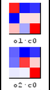

Пример, фильтр 3×3 с красной полосой слева и синей справа — это детектор вертикального края: он даёт высокий отклик там, где слева тёмное, а справа светлое (или наоборот). Фильтр с красным в центре и синим по краям — детектор пятна (blob). Фильтр с диагональной полосой — детектор диагонального края.

Один и тот же фильтр применяется ко всем позициям изображения (weight sharing). Поэтому если край сдвинулся на 5 пикселей вправо, фильтр всё равно его найдёт — просто в другом месте карты признаков. Это и есть инвариантность к сдвигу.

Если фильтры выглядят как случайный шум — это может значить, что сеть не обучилась (слишком мало эпох, слишком большой lr, или баг в backward). Нормальные фильтры первого слоя всегда похожи на края/градиенты — это фундаментальное свойство CNN.

Активации

Активации отвечают на вопрос «что сеть видит на этой картинке». 
Для MNIST это 32 карты 28×28, и на них видно цифру: у фильтра «вертикальный край» горит вертикальная палочка от «7», у «горизонтальный край» — верхняя палочка. 
Это и есть «что видит сеть».

На картинках — один и тот же пример (цифра «7»), прогнанный через слои

вход (сама цифра)
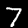

выход свёртки (до активации): 32 карты, на каждой — отклик своего фильтра
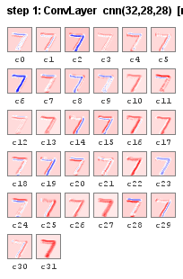

выход после LeakyReLU: отрицательные значения ослаблены, положительные усилены
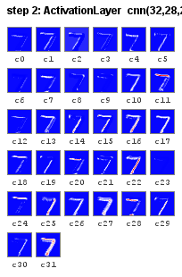

выход после пулинга: карты уменьшились вдвое, но самое сильное сохранилось
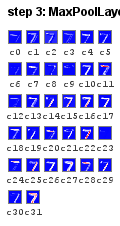

второй свёрточный слой: теперь фильтры ищут не края, а комбинации краёв (углы, палочки)
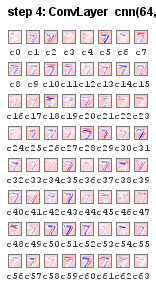

после активации второго слоя
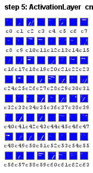

Сравните step-01-conv и step-04-conv: на первом — простые края, на втором — уже более сложные паттерны. 
Это и есть иерархия признаков

## Визуализируем семантическую сегментацию

Фильтры

Веса первого свёрточного слоя (сетка фильтров).

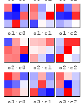

Активации

Вход (само изображение): цветные фигуры — круг, квадрат, треугольник — на фоне. 
Это то, что подаётся в сеть.


Выход первой свёртки (до активации): 16 карт, на каждой — отклик своего фильтра. У фильтра «вертикальный край» горит вертикальная граница фигуры, у «цветовой переход» — граница между цветами. На этом этапе сеть ещё не видит фигуру целиком — только её края и цветовые границы.
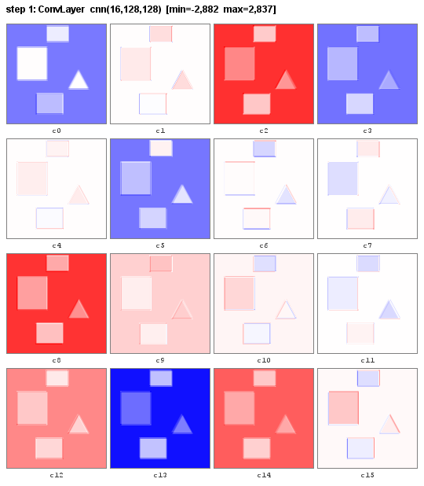

Выход после LeakyReLU: отрицательные значения ослаблены, положительные усилены. Границы стали ярче, слабые отклики почти погасли — сеть «подчёркивает» то, что считает важным.
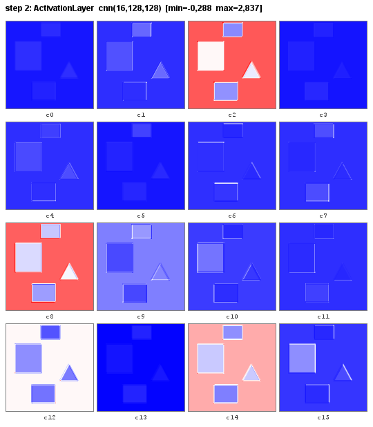

Выход после пулинга: карты уменьшились вдвое, но самое сильное сохранилось. Сеть отбрасывает точное положение границы, оставляя факт её наличия — это делает признаки устойчивее к небольшим сдвигам.
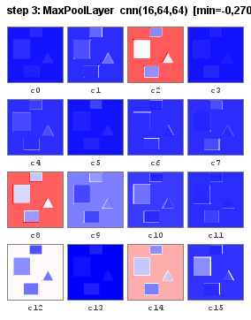

Второй свёрточный слой: теперь фильтры ищут не края, а комбинации краёв — контуры фигур. На картах начинают проступать замкнутые границы круга, квадрата, треугольника. Это и есть иерархия признаков: слой 1 — края и цветовые переходы, слой 2 — контуры фигур.
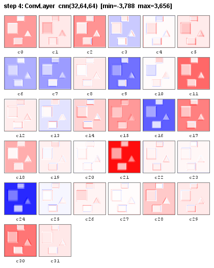

После активации второго слоя: контуры стали чётче, фон подавлен. Сеть всё лучше отделяет «фигуру» от «не-фигуры».
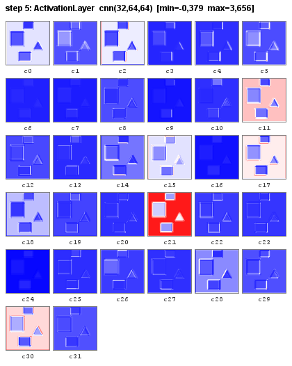

Глубокий слой: на картах видны маски целых объектов. Сеть видит не края и не контуры, а сами фигуры
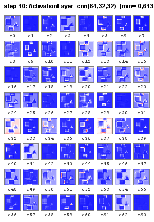

