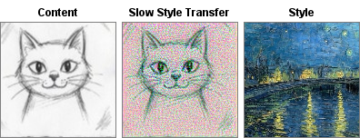
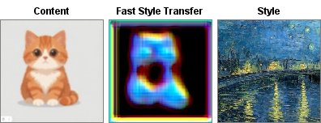

# Глава 3. Перенос стиля одной картинки на другую(Style Transfer).md

## Что это вообще такое

Пусть у нас есть две картинки:
- Фото кошки
- Любая картина Ван Гога.

Мы хотим получить третью картинку: «кошка, нарисованная в стиле Ван Гога».
То есть, по форме она похожа на кошку (те же контуры, тот же объект), а по текстуре, цвету и стилю на картину Ван Гога.

Формально, наш выход, искомая третья картинка, должна по содержанию быть первой, а по стилю второй.

Почему нельзя просто смешать пиксели (например как output = 0.5·content + 0.5·style)?

Потому, что мы получим полупрозрачную кашу, не похожую ни на то , ни на, то .
Пиксели не несут информации о «содержании» или «стиле». 
Пиксель — это просто яркость в точке. Сравнивая пиксели, мы сравниваем яркости, а не смысл.

Нужен способ измерять «похожесть по содержанию» и «похожесть по стилю» отдельно от пикселей.

## Ключевая идея Style Transfer

Смотреть не на пиксели, а на фичи CNN.

Пример абстрактной CNN-сети в вакуме:
```text
картинка → Conv → Conv → Pool → Conv → ... → Dense → класс
```

Каждый слой внутри — это набор «карт признаков» (feature maps). И они устроены иерархически:

| Слой | Что «видит» |
| --- | --- |
| Ранние (1–3) | Края, градиенты, простые текстуры, цветовые пятна |
| Средние (4–6) | Углы, кривые, повторяющиеся паттерны |
| Глубокие (7+) | Части объектов, «глаз», «колесо», «лапа» |

Идея Gatys (2015): содержание и стиль можно измерить через эти фичи, и не нужно ничего обучать заново — достаточно уже обученной CNN.
- Содержание ≈ «где какие объекты» → ранние/средние слои.
- Стиль ≈ «какие текстуры/цвета/паттерны встречаются» → средние слои, но без привязки к месту


## Функция потерь для Style Transfer

Нам нужна функция потерь, ведь именно она определяет чему обучится нейросеть

- Content loss: «у тебя должна быть та же композиция» (те же объекты в тех же местах).
- Style loss: «у тебя должен быть тот же набор мазков» — не важно, где именно ты положишь мазок «ярко-жёлтый рядом с синим», главное, чтобы такие сочетания были.

Gram matrix — это просто статистика «какие мазки с какими соседствуют».

Представьте, что у вас есть 4 канала: «вертикальный край», «горизонтальный край», «пятно красного», «пятно синего».
Если на картине Ван Гога часто встречается «красное рядом с синим» — то G[красный][синий] будет большим.
Если «вертикальный край» никогда не соседствует с «горизонтальным» — G[верт][гор] ≈ 0.
Gram-матрица — это таблица C×C, где на пересечении c1 и c2 записано, насколько часто эти два паттерна встречаются в одной точке.

### Content loss — как измерить «похожесть по содержанию»

- Прогнать content(содержимое) через CNN, остановиться на слое L, сохранить его фичи: F_content.
- Прогнать output(выход) через CNN, остановиться на том же слое L, сохранить: F_output.
- Сравнить их поэлементно:
```text
L_content = среднее( (F_output − F_content)² )
```

Чем ближе фичи — тем «похожее содержание». Всё. Это обычный MSE, только не по пикселям, а по фичам среднего слоя.

Почему это работает: если у output и content одинаковые фичи на среднем слое — значит на этом слое «видны те же объекты в тех же местах». 
Значит и форма та же.

### Style loss  - как измерить "похожесть по стилю"

Стиль — это не «где», а «что». Нам не важно, где именно на картине Ван Гога нарисован завиток — важно, что завитки есть и они такого типа.

Как это измерить по фичам?

Пусть на слое L у нас C каналов (карт признаков), каждая H×W. 
Один канал = один «детектор» какого-то паттерна (например, «вертикальный край», «пятно красного», «завиток»).
Если канал c «сработал» в точке (h,w) — значит в этой точке есть паттерн типа c.

>Что значит: канал сработал в точке (h,w)
> 
> Выход слоя L — тензор C × H × W. 
> Один канал c — это 2D-массив чисел featureMap[c][h][w]. 
> Каждое число — это непрерывный отклик детектора c в позиции (h, w). 
> Не бинарный флаг, не «пиксель».
> 
> Сработал - значение заметно выше типичного для этого канала».
> После ReLU все значения ≥ 0 (отрицательные обнуляются — это и есть «не сработал»). 
> После LeakyReLU отрицательные слабо положительные, но всё равно малы

Мы хотим, чтобы в output встречались те же сочетания паттернов, что и в style. То есть:

Если в style в какой-то точке одновременно сработали каналы 3 и 7 — то и в output где-то должны сработать 3 и 7 вместе.

Не важно где. Важно что вместе.

Строим матрицу G(Gram matrix) размера C × C:
```text
G[c1][c2] = сумма по всем (h,w)  F[c1,h,w] · F[c2,h,w]

где F это карта признаков (feature map), полученная на выходе одного из слоёв свёрточной нейронной сети (CNN)
```
- G[c1][c2] — большое число → каналы c1 и c2 «любят включаться вместе» (это и есть характерная текстура).
- G[c1][c2] — ноль → каналы никогда не активны одновременно (эти паттерны не встречаются рядом).

>в коде Gram нормируется на HW, чтобы loss не зависел от размера карты признаков

Gram matrix полностью игнорирует расположение пикселей. Это и есть «стиль».

1. G_style = Gram matrix фич style на слое L.
2. G_output = Gram matrix фич output на том же слое.
3. L_style = среднее( (G_output − G_style)² ).
Это и есть "Style loss"

Обычно берут несколько слоёв (2–3) и складывают потери — так захватываются и мелкие текстуры (ранние слои), и крупные (поздние).

## Как сделать выходную картинку

**Мы оптимизируем не веса нейросети, а сами пиксели картинки!**

Веса CNN заморожены. Мы «крутим» пиксели output, чтобы уменьшить сумму:
```text
L_total = α · L_content + β · L_style
```

Общий алгоритм
```text
Дано 
    2-е картинки style, content
    обученная cnn-нейросеть
Надо получить
    третью картинку output = content в стиле style    

1. Начать с output = content (или content + немного шума)
2. Повторить N раз:
   a. Прогнать content, style, output через CNN  →  получить фичи на нужных слоях
   b. Посчитать L_content  (MSE фич content vs output)
   c. Посчитать L_style    (MSE Gram-матриц style vs output)
   d. Сложить:  L = α·L_content + β·L_style
   e. Вычислить градиент L по пикселям output
      (через обычный backprop, но остановиться на входе — до входа сети, т.е. до пикселей)
   f. Обновить пиксели:  output -= lr · градиент
3. Вернуть output


Это та же самая backpropagation, что и при обучении! Только:
    градиент течёт до самого входа (не до весов);
    обновляем не веса, а вход;
    веса не трогаем вообще.
```

Нам потребуются методы
```java
    /**
     * Прогоняет вход через слои модели <b>до слоя {@code lastInclusive}
     * включительно</b> и возвращает выход этого слоя.
     *
     * <p>Используется для Style Transfer и подобных задач, где нужны
     * «фичи» на промежуточном слое, а не выход всей сети.
     *
     * <p><b>Кэш.</b> Внутри слоёв сохраняются активации, поэтому после
     * вызова можно звать {@link #backwardFrom(Model, int, float[])} с тем
     * же или меньшим {@code lastInclusive} без повторного forward.
     *
     * <p><b>Поддерживаемые модели.</b> {@link Sequence} (линейный список
     * слоёв) и {@link Functional} <b>без ветвлений</b> (линейный DAG —
     * когда у каждого узла, кроме input, ровно один вход). Для DAG с
     * {@code Merge} метод бросает {@link UnsupportedOperationException}:
     * частичный backward через ветвление некорректен (градиент должен
     * разветвляться).
     *
     * @param model         модель; не {@code null}
     * @param input         входной вектор длины {@code model.inputShape().size()}
     * @param lastInclusive индекс последнего слоя (0-based, включительно);
     *                      {@code 0 <= lastInclusive < layersCount}
     * @return выход слоя {@code lastInclusive}
     * @throws IllegalArgumentException если индекс вне диапазона или длина
     *                                  входа не совпадает
     * @throws UnsupportedOperationException если модель — не Sequence и не
     *                                       линейный Functional
     */
    static float[] forwardUpTo(Model model, float[] input, int lastInclusive) {
        java.util.List<Layer> layers = linearLayers(model);
        if (lastInclusive < 0 || lastInclusive >= layers.size())
            throw new IllegalArgumentException("forwardUpTo: lastInclusive=" + lastInclusive + " вне [0, " + layers.size() + ")");
        if (input.length != model.inputShape().size())
            throw new IllegalArgumentException("forwardUpTo: ожидалось " + model.inputShape().size() + " входных значений, получено " + input.length);

        float[] cur = input;
        for (int i = 0; i <= lastInclusive; i++)
            cur = layers.get(i).forward(cur, false);
        return cur;
    }

    /**
     * Прокидывает градиент от выхода слоя {@code fromLayer} назад до входа
     * сети и возвращает {@code dL/dInput}.
     *
     * @param model              модель
     * @param fromLayer          индекс слоя (0-based), с выхода которого
     *                           начинается backward
     * @param deltaAtLayerOutput градиент по выходу слоя {@code fromLayer};
     *                           длина = {@code layers[fromLayer].outputShape().size()}
     * @return градиент по входу сети; длина = {@code model.inputShape().size()}
     * @throws IllegalArgumentException если индекс или длина не совпадают
     * @throws UnsupportedOperationException если модель не поддерживается
     */
    static float[] backwardFrom(Model model, int fromLayer, float[] deltaAtLayerOutput) {
        java.util.List<Layer> layers = linearLayers(model);
        if (fromLayer < 0 || fromLayer >= layers.size())
            throw new IllegalArgumentException("backwardFrom: fromLayer=" + fromLayer + " вне [0, " + layers.size() + ")");

        int expected = layers.get(fromLayer).outputShape().size();
        if (deltaAtLayerOutput.length != expected)
            throw new IllegalArgumentException("backwardFrom: deltaAtLayerOutput.length=" + deltaAtLayerOutput.length + " != outputSize=" + expected);

        float[] d = deltaAtLayerOutput;
        for (int l = fromLayer; l >= 0; l--)
            d = layers.get(l).backward(d);
        return d.clone();
    }

    /**
     * Возвращает слои модели в порядке forward для
     * {@link #forwardUpTo}/{@link #backwardFrom}.
     *
     * <p>Для {@link Sequence} — {@code layersForPrint()}.
     * Для {@link Functional} — топологический порядок {@code debugTopo()},
     * <b>только</b> если DAG линейный (у каждого узла, кроме input, ровно
     * один вход). Иначе — {@link UnsupportedOperationException}.
     *
     * @throws UnsupportedOperationException если модель не Sequence и не линейный Functional
     */
    private static java.util.List<Layer> linearLayers(Model model) {
        if (model instanceof Sequence seq) {
            java.util.List<Layer> out = new java.util.ArrayList<>();
            for (Layer l : seq.layersForPrint()) out.add(l);
            return out;
        }
        if (model instanceof Functional fn) {
            java.util.List<Layer> out = new java.util.ArrayList<>();
            for (Functional.Node n : fn.debugTopo()) {
                if (n.inputs.size() > 1) throw new UnsupportedOperationException("forwardUpTo/backwardFrom: Functional с ветвлениями " + "(узел '" + n.name + "' имеет " + n.inputs.size() + " входов) не поддерживается — используйте Sequence");
                if (n.layer != null) out.add(n.layer);
            }
            return out;
        }
        throw new UnsupportedOperationException(
                "forwardUpTo/backwardFrom: поддерживаются только Sequence и "
                        + "линейный Functional, получено " + model.getClass().getName());
    }

    /**
     * Возвращает список слоёв модели в порядке forward (только для
     * {@link Sequence} и линейного {@link Functional}).
     *
     * <p>Нужен, чтобы получить {@link Layer#outputShape()} слоя по индексу
     * (например, для расчёта размера фич в Style Transfer).
     *
     * @throws UnsupportedOperationException если модель не поддерживается
     */
    static java.util.List<Layer> layers(Model model) {
        return java.util.Collections.unmodifiableList(linearLayers(model));
    }
```

Причём саму CNN-сеть можно взять практически любую!

Каждая итерация = 3 forward + 2 backward прохода по CNN. 
Чтобы картинка стала красивой, нужно 200–500 итераций. 
Будет медленно

Именно поэтому в 2016-м придумали fast style transfer: обучить отдельную сеть, которая делает всё за один forward. 
Но это уже другая история, и там нужно сначала обучить (медленно), потом применять (быстро).

---
## Медленный подход - учим картинку-контент пока не станет похожей на стиль

 Краткое резюме

- Стиль-трансфер = оптимизация картинки, а не весов. Веса CNN заморожены, крутим пиксели.
- Content loss = MSE фич output и content на среднем слое. Отвечает за форму.
- Style loss = MSE Gram-матриц фич output и style на нескольких слоях. Отвечает за текстуру. Gram = матрица «какие каналы активны вместе», игнорирует где именно.
- Цикл: forward до нужных слоёв → посчитать два loss'а → backward до входа → шаг по пикселям. Повторить 200–500 раз.


Представьте, что у вас есть холст с нарисованной кошкой, и картина Ван Гога рядом. Вы хотите перерисовать кошку мазками Ван Гога.

Вы не рисуете заново — вы берёте кошку и постепенно подправляете её: где-то добавляете жёлтый мазок, где-то — синий завиток. На каждом шаге смотрите:
- «кошка ещё узнаваема?» (content loss);
- «похоже на Ван Гога?» (style loss).

Если что-то не так — подправляете чуть-чуть в нужную сторону. Через 300–600 шагов получается «кошка в стиле Ван Гога».

Ключевое: вы не учите нейросеть. Вы крутите пиксели картинки. CNN — это «судья», который говорит, «насколько похоже на кошку» и «насколько похоже на Ван Гога».

---
## Быстрый подход - учим сеть перерисовывать по стилю

Представьте, что у вас есть художник-ученик (сеть S), и одна картина Ван Гога как образец.

Вы показываете ученику случайную картинку («нарисуй вот это»), он рисует свою версию. Вы смотрите:

«форма сохранилась?» (content loss — сравниваете с исходной картинкой);

«похоже на Ван Гога?» (style loss — сравниваете с картиной-образцом).

Если нет — говорите ученику, что не так, он чуть-чуть корректирует свою манеру. Через 1000–2000 таких показов ученик выучивает манеру Ван Гога. После этого вы даёте ему любую картинку — он рисует её в стиле Ван Гога, причём сразу (без 300 итераций).

Ключевое: в отличие от SlowStyleTransfer (там крутили пиксели одной картинки), здесь крутим веса ученика S. После обучения S — готовая сеть, которая за один forward стилизует что угодно.

---

## Идём в код

[задача-переноса-стилей-с-одной-картинки-на-другую](tasks/Задачи.md#задача-переноса-стилей-с-одной-картинки-на-другую)

### Slow style transformer

[StyleOps](tasks/styleTransform/StyleOps.java)  — математика

| Метод | Что считает |
| --- | --- |
| contentLoss(F_out, F_content) | mean((F_out − F_content)²) |
| contentLossGrad(F_out, F_content, gradOut) | dL/dF_out = 2·(F_out − F_content)/N |
| gram(F, shape) | Gram-матрица G[c1][c2] = (1/HW)·Σ F[c1,h,w]·F[c2,h,w] |
| gramLoss(G_out, G_style) | mean((G_out − G_style)²) |
| gramLossGrad(F_out, G_out, G_style, shape, gradOut) | dL/dF[c,h,w] = (4/(C·C·HW))·Σ_{c'} (G_out[c,c']−G_style[c,c'])·F_out[c',h,w] |

>Коэффициент 4 (4/(C·C·HW)) — потому что MSE по симметричной матрице даёт 2, и производная Грама даёт ещё 2 (по каждому из двух вхождений F)

[SlowStyleTransfer](tasks/styleTransform/SlowStyleTransfer.java) — медленный (Gatys 2015)

Оптимизирует пиксели одной картинки. Веса CNN заморожены. Один вызов = одна картинка (не учит модель)

```text
static BufferedImage transfer(
    Model cnn,                    // обученная CNN, заморожена
    BufferedImage content,        // «форма»
    BufferedImage style,          // «текстура»
    int contentLayer,             // индекс слоя для content loss
    int[] styleLayers,            // индексы слоёв для style loss
    float alpha, float beta,      // веса
    int iterations, float lr)     // гиперпараметры оптимизации
```

Шаг 0. Запомнить «эталон»
```text
contentFeatures = CNN(content) на слое contentLayer
styleGram       = Gram(CNN(style)) на каждом styleLayers[k]

Это то, к чему мы стремимся. Считаем один раз, потому что content и style не меняются.
```

Шаг 1. Начать с content
```text
output = content   ← копия пикселей

Почему не с белого листа? Потому что форма уже есть — её не надо «изобретать». 
Стиль будем «наращивать» сверху.
```

Шаг 2. Цикл (300–600 раз). На каждом шаге
```text
Прогнать output через CNN до самого глубокого нужного слоя.

Посчитать «насколько плохо»:
    content loss = насколько фичи output отличаются от фич content. Мало → форма сохранена. Много → форма «поплыла».
    style loss = насколько Gram-матрица output отличается от Gram style. Мало → текстура похожа. Много → текстура не та.
    
Понять, в какую сторону менять пиксели (backward):
    content loss «тянет» пиксели к форме;
    style loss «тянет» к текстуре.    
общий градиент = α · (к форме) + β · (к текстуре)

Сдвинуть пиксели на маленький шаг lr в направлении «уменьшить потери»:  output -= lr · общий градиент

Обрезать в [0, 1] — иначе пиксели «улетят» в бесконечность и картинка будет «мусор».    
```

Шаг 3. Вернуть output как картинку.
Конец

Почему β/α — главный параметр
- β/α = 10 — чуть-чуть стиля (форма доминирует);
- β/α = 100 — «видно стиль, видно форму» (норма);
- β/α = 1000 — «каша в стиле» (форма размывается).



```terminaloutput
11:24:20.418 [main] INFO rawnet.docs.flows.main.cnn.tasks.styleTransform.StyleDemo -- === SLOW Style Transfer (600 итераций) ===
11:24:20.418 [main] INFO rawnet.docs.flows.main.cnn.tasks.styleTransform.StyleDemo --   contentLayer=9, styleLayers=[0, 3, 6, 9], α=1.0, β=500.0
  it   1/600   content=0,0000  style=27,0333
  it  50/600   content=4,7634  style=2,1577
  it 100/600   content=5,2404  style=1,5298
  it 150/600   content=5,4935  style=1,2391
  it 200/600   content=5,6657  style=1,0565
  it 250/600   content=5,7939  style=0,9273
  it 300/600   content=5,8931  style=0,8293
  it 350/600   content=5,9743  style=0,7515
  it 400/600   content=6,0423  style=0,6879
  it 450/600   content=6,1002  style=0,6345
  it 500/600   content=6,1504  style=0,5888
  it 550/600   content=6,1927  style=0,5493
  it 600/600   content=6,2302  style=0,5146
```

Проблема в том, что модели обучены только на ShapeImageGenerator — синтетические фигуры на простом фоне.
Она никогда не видела:
- мазков, завитков;
- реальных текстур (масло, холст, трава, небо);
- Ван Гога (или Шишкина) в частности.

По хорошему надо обучить экстрактор (и другие модели) на реальных картинках с которых будем снимать стиль.

### Fast style transfer

В чём проблема Gatys: 300 итераций × (3 forward + 2 backward) по всей CNN = 1–2 минуты на картинку.

Обучим нейросеть вида stylized = T(content).
После обучения T — это «застывший перенос стиля». Её можно применить к любой картинке, и она мгновенно отдаст стилизованный результат.

Функция потерь та же, что у Gatys — content loss + style loss через замороженный VGG. 
Меняется только то, к чему применяется градиент.

```text
stylized = T(content)

L_content = MSE( VGG(stylized)_Lc,   VGG(content)_Lc )       ← та же формула
L_style   = MSE( Gram(VGG(stylized)_Ls), Gram(VGG(style)_Ls) )
L_tv      = TV(stylized)                                        ← новое: сглаживание
L_total   = α · L_content + β · L_style + γ · L_tv

α, β, γ — константы, не обучаются (как и в Gatys).
```

Что оптимизируется: веса T: матрицы W во всех ConvLayer и параметры γ, β во всех InstanceNormLayer внутри T. 
Градиент dL_total/dWeights_T течёт через T (её backward) → накапливается в T.weightGrad → T.update(optimizer) обновляет.

Один стиль = одна модель. Нейронка создаётся один раз. Чтобы переобучить — удалите сеть и запустите снова

[StyleStylizer](tasks/styleTransform/StyleStylizer.java) архитектура сети-стилизатора

```text
cnn(3,128,128)
  Conv(16, k=3, s=2, p=1) → LeakyReLU          → cnn(16, 64, 64)
  Conv(32, k=3, s=2, p=1) → LeakyReLU          → cnn(32, 32, 32)
  Conv(64, k=3, s=1, p=1) → LeakyReLU          → cnn(64, 32, 32)
  Conv(64, k=3, s=1, p=1) → LeakyReLU          → cnn(64, 32, 32)    (bottleneck)
  Upsample(2) → Conv(32) → IN → LeakyReLU      → cnn(32, 64, 64)
  Upsample(2) → Conv(16) → IN → LeakyReLU      → cnn(16,128,128)
  Conv(3, k=1)                                 → cnn(3, 128, 128)
```
```java
//apply(Sequence stylizer, BufferedImage img) → BufferedImage
float[] in  = toFlatRgb(img);                // [0,1]
float[] out = stylizer.forward(in, false);    // forward, dropout off
for (i) out[i] = clip(out[i], 0, 1);          // клип
return fromFlatRgb(out, w, h);
```

[StyleStylizerTrainer](tasks/styleTransform/StyleStylizerTrainer.java) — обучение стилизатора

Обучает StyleStylizer на одной стилевой картинке.
Content-картинки генерируются генератором фигур (ImageDatasetGenerator), а не берутся из датасета; это позволяет учить S на бесконечном разнообразии форм

Почему модель работает на новых картинках?
Потому что модель учится не «запомнить стиль для одной картинки», а «манеру»: какие операции над пикселями дают нужную текстуру.
Вход — любая картинка; выход — та же картинка, но с наложенной манерой.
Если модель видела 1000 разных фигур и на каждой училась накладывать стиль — она выучила операцию «наложить стиль», а не «запомнила одну картинку».

```text
static Sequence train(
    Sequence stylizer,            // пустой S (StyleStylizer.build)
    Model cnn,                    // обученная CNN (заморожена, не учится);
    BufferedImage style,          // одна стилевая картинка(картинка - образец)
    ImageDatasetGenerator gen,    // генератор случайных картинок (для content)
    int contentLayer,             // индекс слоя CNN для content loss
    int[] styleLayers,            // индексы для style loss
    float alpha, float beta,      // веса (β адаптивный внутри)
    int iterations, float lr)
```

Сеть-стилизатор вида "картинка->картинка"
```text
вход:  cnn(3, 128, 128)      ← любая картинка
  ↓
энкодер: сжимает до 32×32    (Conv с stride=2)
  ↓
bottleneck: 64 канала         (Conv)
  ↓
декодер: разжимает до 128×128 (Upsample)
  ↓
выход: cnn(3, 128, 128)      ← та же картинка, но «в стиле»
```

Сеть не знает, какая картинка на входе — она всегда пытается наложить один и тот же стиль. 
После обучения S(x) для любого x даёт «x в этом стиле».

Шаг 0. Запомнить «эталон стиля»
```text
styleGram = Gram(CNN(style)) на каждом styleLayers[k]

Это то, к чему стремимся по текстуре. style не меняется — считаем один раз.
```

Шаг 1. Цикл (1000–2000 раз)
```text
Сгенерировать случайную картинку x: x = gen.generateOne(GRID)    ← новая картинка каждый раз

Пропустить x через S: y = S(x, training=true)    <-что нарисовал ученик

Обрезать y в [0, 1] (пиксели должны быть валидными): yClipped = clip(y, 0, 1)

Прогнать yClipped и x через CNN — получить фичи:
    fContentY = CNN(yClipped) на contentLayer   ← «форма того, что нарисовал»
    fContentX = CNN(x)        на contentLayer   ← «форма оригинала»
    fStyleY   = CNN(yClipped) на styleLayers[k] ← «текстура того, что нарисовал»
    
Посчитать «насколько плохо»:
    content loss = MSE(fContentY, fContentX) — «насколько форма поплыла»;
    style loss = MSE(Gram(fStyleY), styleGram[k]) — «насколько текстура не та».    
    
Понять, в какую сторону менять S (backward):
    content loss «тянет» S к сохранению формы;
    style loss «тянет» S к стилю.    
общий градиент по y = α · (к форме) + β_it · (к стилю)    

Прокинуть градиент назад через S:  S.backward(общий градиент)    ← «понять, какие веса S виноваты»

Обновить веса S (шаг AdamW): S.update(opt, batchSize=1)
```

Шаг 2. Вернуть S

После обучения S(x) для любой новой картинки x даёт «x в стиле Ван Гога» за один forward

**Секрет: адаптивный β — чтобы S не «схитрил»**
Если β постоянный, S находит ленивое решение: «ничего не делать». Тогда:
- content loss = 0 (S(x) = x, форма идеальна);
- style loss большой (но S и не пытается его уменьшить — «я не трогаю вход»).

Это локальный минимум. S «думает»: «зачем ломать форму ради стиля?» — и не учится.

Решение — β в начале в 4 раза больше:
```text
progress = it / iterations;              // 0..1
β_it = β · (1 + 3·(1 - progress));      // 4β в начале → β в конце
```
Первые итерации: β_it = 4β — стиль сильно доминирует, S вынужден отойти от «ничего не делать».

К концу: β_it = β — S стабилизирует форму.

Без адаптивного β S схлопывается в тождество за первые 50 итераций, и style застывает



```terminaloutput
11:25:30.189 [main] INFO rawnet.docs.flows.main.cnn.tasks.styleTransform.StyleDemo -- === FAST Style Transfer: обучение (1000 итераций) ===
11:25:30.189 [main] INFO rawnet.docs.flows.main.cnn.tasks.styleTransform.StyleDemo --   contentLayer=9, styleLayers=[0, 3, 6, 9], α=1.0, β=500.0
  it    1/1000   content=0,0000  style=49,6219  β=2000,0
  it   50/1000   content=0,0000  style=1,1405  β=1926,4
  it  100/1000   content=0,0000  style=1,2665  β=1851,4
  it  150/1000   content=0,0000  style=0,8217  β=1776,3
  it  200/1000   content=0,0000  style=0,3656  β=1701,2
  it  250/1000   content=0,0000  style=0,4414  β=1626,1
  it  300/1000   content=0,0000  style=0,4041  β=1551,1
  it  350/1000   content=0,0000  style=0,2565  β=1476,0
  it  400/1000   content=0,0000  style=0,3385  β=1400,9
  it  450/1000   content=0,0000  style=0,3310  β=1325,8
  it  500/1000   content=0,0000  style=0,1934  β=1250,8
  it  550/1000   content=0,0000  style=0,5207  β=1175,7
  it  600/1000   content=0,0000  style=0,1780  β=1100,6
  it  650/1000   content=0,0000  style=0,2198  β=1025,5
  it  700/1000   content=0,0000  style=0,2502  β=950,5
  it  750/1000   content=0,0000  style=0,1526  β=875,4
  it  800/1000   content=0,0000  style=0,2839  β=800,3
  it  850/1000   content=0,0000  style=0,2281  β=725,2
  it  900/1000   content=0,0000  style=0,2148  β=650,2
  it  950/1000   content=0,0000  style=0,1995  β=575,1
  it 1000/1000   content=0,0000  style=0,1207  β=500,0
```

>Почему content=0,0000 ? Возможно contentLayer=9 - слой слишком глубокий (после нескольких MaxPool фичи «схлопываются») + лой после InstanceNorm (нормировка вымывает различия)
> Но на всякий случай проверить на баг в коде (позже)