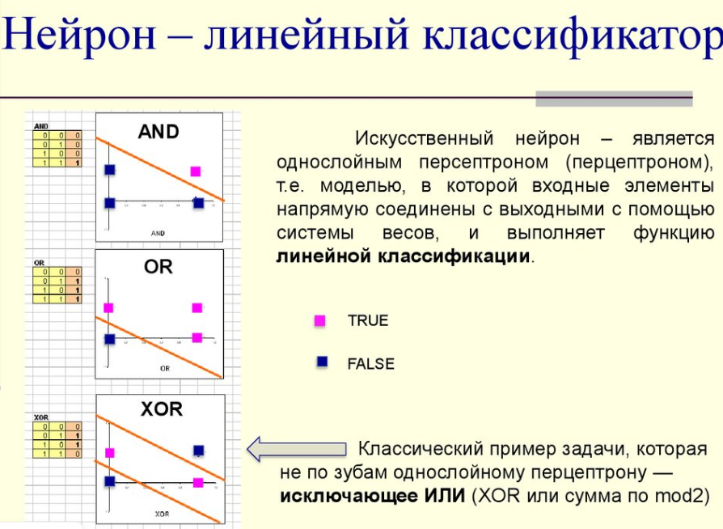
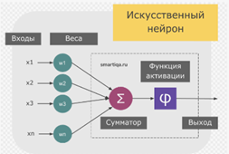
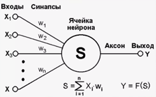
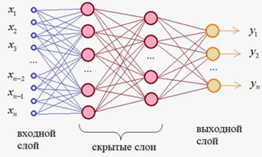
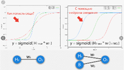

# Глава 1. Что такое нейросеть и зачем она нужна?

## Что такое нейросеть?

Вообще-то это математическая модель, придуманная на основе обычного биологического нейрона, но ушедшая о-о-очень далеко и почти никак не связанная со своим биологическим прообразом.

Её сила в умении на множестве примеров входных/выходных данных извлечь и запомнить в себе скрытые закономерности, позволяющие по входным данным, выдавать выходные.

Нейросеть нужна там, где обычные правила трудно или невозможно описать явно. Мы можем легко написать формулу для расчёта площади прямоугольника, но не можем вручную прописать все правила распознавания речи или перевода текста. Нейросеть позволяет извлекать сложные закономерности из примеров.

### Нейросеть как идея это

Идея нейросети в том, чтобы научить машину «понимать» закономерности не по жёстким правилам, а через опыт, почти как учится человек.

Нейросеть — парадигма: вместо того чтобы описывать мир правилами, мы позволяем системе вывести правила из опыта. Именно эта идея лежит в основе современного машинного обучения и ИИ.

Нейросеть как идея ставит вопрос: можно ли считать, что система, обученная на данных, «понимает» закономерности, или она просто запоминает статистику?
Это мост между жёстким детерминизмом алгоритмов и гибкостью живого познания.

### Математически нейросеть это

В базовом виде это математическая функция, которая принимает данные и выдаёт ответ.
Отличие от обычной формулы в том, что её параметры не задаются вручную, а подбираются по примерам.
Именно поэтому нейросеть может решать задачи, где трудно сформулировать точные правила: распознавать лица, переводить текст, предсказывать спрос, находить мошеннические операции.

Нейросеть сама по себе не «понимает» смысл признаков (признак - одиночная характеристика объекта).
Она ищет математическую зависимость между входом и выходом.
Если данные плохие, признаки неинформативные или ответы противоречивы, хорошая модель не появится.

Обучение нейросети — это поиск параметров (весов и смещений), при которых средняя ошибка на обучающих данных минимальна.
Формально мы решаем задачу оптимизации функции потерь.

**Функция потерь (loss function)** — это мера того, насколько сильно предсказания модели отличаются от истинных целевых значений на обучающих примерах.
Именно её значение используется для обновления весов сети в процессе обучения: мы стремимся найти такие параметры модели, которые минимизируют среднее значение функции потерь по всей обучающей выборке.
Собственно весь процесс обучения это и есть уменьшение функции потерь.

Поэтому
- Все знания нейросети, всё чему она обучилась как раз и хранятся только и исключительно в весах смещений и связей между нейронами.
- То, чему обучится наша нейросеть определяется одной только функцией потерь (архитектура, гиперпараметры обучения - вторичны. Они помогают или мешают обучению, но не влияют на то, чему пытается обучиться нейросеть).


## Перцептрон

Это база. А базу надо знать!

Перцептрон — это простейшая нейросеть, состоящая из одного нейрона.
Он умеет принимать несколько входов, взвешивать их, суммировать и выдавать ответ.

>Строго говоря перцептрон — это историческая модель: один нейрон с пороговой активацией и специальным правилом обучения, которое не является градиентным спуском.
>Современный нейрон это не перцептрон Розенблатта. Но нафиг историю. Даёшь практику.
>Поэтому, чтобы не размазывать понимание будем считать что это примерно оно и есть.

Простейшее объяснение перцептрона:

Представь, что ты решаешь, идти ли на прогулку. Ты смотришь на несколько признаков: температура, наличие дождя, свободное время. У каждого признака есть важность. Если на улице тепло — это плюс. Если дождь — минус. Если время есть — плюс. Ты складываешь всё с учётом важностей. Если итоговая сумма выше порога — идёшь.

Перцептрон делает то же самое. У него есть веса — важности каждого входа. Он умножает вход на вес, складывает, добавляет смещение и пропускает через функцию активации. Если результат выше порога — выдаёт 1, иначе 0.

Обучение выглядит так: перцептрон ошибается, мы говорим ему «правильный ответ был другой», и он немного сдвигает веса в нужную сторону. Повторяем много раз — веса постепенно настраиваются.

---

Объяснение посложнее:

Перцептрон — это функция:

$$
z = \sum_{i=1}^{n} w_i x_i + b = \mathbf{w}^\top \mathbf{x} + b, \quad \hat{y} = \phi(z).
$$

где x — входной вектор, w — веса, b — смещение, ϕ — функция активации.

Правило обучения перцептрона:

$$
w_i \leftarrow w_i + \eta (y - \hat{y}) x_i, \quad b \leftarrow b + \eta (y - \hat{y}).
$$

где η — скорость обучения. Если ответ правильный, ничего не меняется. Если неправильный — веса сдвигаются в сторону уменьшения ошибки.

Важная оговорка: это правило — именно для классического перцептрона Розенблатта с пороговой (ступенчатой) активацией и метками y∈{0,1} (или {−1,+1}). Для нейрона с произвольной гладкой активацией и произвольной функцией потерь правило другое — это градиентный спуск, который мы разберём ниже.

Ограничение перцептрона. Один нейрон может разделить пространство только одной гиперплоскостью (в двумерном случае — прямой).
Он не может выучить XOR, потому что XOR не является линейно разделимой задачей



На рисунке видно, что точки классов (0,0), (1,1) и (0,1), (1,0) нельзя отделить одной прямой.
Как ни крути, одна из точек всегда окажется не с той стороны.

Перцептрон — это базовый строительный блок.
Из многих перцептронов, соединённых вместе, получается многослойный перцептрон.

## Одиночный нейрон

Одиночный нейрон — это тот же перцептрон, но в контексте многослойной сети: он получает входы от предыдущего слоя, взвешивает, суммирует, добавляет смещение и пропускает через активацию.
Отличие от перцептрона-«одиночки» только в том, что здесь нейрон — один из многих, и его выход идёт дальше.

\


## MLP: многослойный перцептрон

Один перцептрон умеет только линейно разделять данные.
XOR ему не под силу.
Но если соединить несколько перцептронов в слои, получается многослойный перцептрон (MLP) — сеть, которая может аппроксимировать любую непрерывную функцию при достаточном числе нейронов в скрытом слое.

**Полносвязанная (MLP) сеть** - сеть в которой каждый нейрон предыдущего слоя связан с каждым нейроном следующего слоя.

**Слой** — это набор нейронов, у которых входы берутся с предыдущего слоя, а выходы идут на следующий.

MLP состоит из:
- входного слоя (данные),
- одного или нескольких скрытых слоёв (перцептроны с нелинейными активациями),
- выходного слоя (ответ).

И каждый нейрон предыдущего слоя связан с каждым нейроном следующего слоя и ни с каким больше.



Представь, что ты решаешь сложную задачу: «стоит ли покупать эту квартиру». Ты не можешь оценить её одним взглядом. Ты сначала оцениваешь район, состояние дома, транспорт, цену. Потом на основе этих промежуточных оценок делаешь вывод.

MLP работает так же. Первый слой нейронов извлекает простые признаки: «район хороший», «дом старый», «метро близко». Второй слой комбинирует эти признаки в более сложные: «локация отличная, но дом требует ремонта». Выходной слой выдаёт итоговое решение.

Ключевая идея: скрытый слой создаёт новые признаки, которых не было во входных данных. Эти признаки не заданы вручную — сеть сама их придумывает в процессе обучения.

Именно поэтому MLP может решить XOR: скрытый слой переводит входы в новое пространство, где XOR становится линейно разделимым.

### Функция активации нейрона

[Функция активации (activation function)](../../../base/term/Функция%20активации.md) — нелинейное преобразование, применяемое к выходу искусственного нейрона после вычисления линейной комбинации его входов.
Именно она наделяет нейронную сеть способностью моделировать сложные, нелинейные зависимости.

Зачем вообще нужна функция активации?

Композиция линейных функций — снова линейная функция.
Это значит, что глубокая сеть из сотен слоёв без нелинейных активаций математически эквивалентна одному линейному слою.
Вся выразительная мощь глубокого обучения исчезает.

### Функция потерь нейросети

[Функция потерь (loss function)](../../../base/term/Функция%20потерь.md) — это мера того, насколько сильно предсказания модели отличаются от истинных целевых значений на обучающих примерах. Именно её значение используется для обновления весов сети в процессе обучения: мы стремимся найти такие параметры модели, которые минимизируют среднее значение функции потерь по всей обучающей выборке.
Собственно весь процесс обучения это и есть уменьшение функции потерь.
Другими словами то, чему и как быстро обучится ваша нейросеть определяется одной только функцией потерь.


### Алгоритм работы mlp

Данные по нейросети текут в две стороны
- от входа к выходу. Это прямой(forward или predict) проход. По входным данным вычислить выходные
- от выхода к входу. Это обратный(backward) проход, он возможен только после выполнения прямого прохода, и его функция - обучение (то есть корректировка параметров нейросети: весов связей и смещений нейронов на всех слоях)

По входным данным вычислили выходные - прямой (forward/predict) проход.

Имея выходные данные (после прямого прохода) и идеальные выходные - вычислить потерю (значение функции потерь) скорректировать параметры нейрона в сторону уменьшения потери (то есть приближения ответа к идеальному ответу).
Это обратный(backward) проход.

Для понимания **почему** работает обучение нейросети необходимо знание 


#### Прямой проход (вычисление)

1. Устанавливаем выходные значения нейронов входного слоя равными вектору входных значений нейросети.
2. Для каждого нейрона каждого последующего слоя:
   1. Вычисляем взвешенную сумму входов нейрона как линейную комбинацию его входов (выход нейрона предыдущего слоя, умноженный на вес связи между нейронами).

   > $$ z = \sum_i w_{i} x_i + b $$ , где
   >+ х – входной вектор размером n x 1
   >+ w – вектор весов входных связей размером 1 x n
   >+ b – смещение (скаляр)

   2. Применяем к полученной сумме функцию активации нейрона, получая выход нейрона данного слоя.

   > $$ a = f(z) = f(w \cdot x + b) $$ где
   > + f – функция активации нейрона

3. Снимаем выходной вектор (вектор ответов нейросети) с нейронов выходного слоя.

##### Обратный проход (обучение)

Может быть запущен только после выполнения прямого прохода.

Обучение нейронной сети сводится к постепенной корректировке весов и смещений (bias) так, чтобы минимизировать функцию потерь — меру несоответствия между предсказанным и истинным значениями.

Прямой проход дал нам ответ сети ŷ и значение потери L(ŷ, y).
Нам нужно уменьшить L, изменив веса w и смещения b.
Для этого нужен градиент потери по каждому параметру: ∂L/∂w и ∂L/∂b.
Обратный проход — это алгоритм, который считает эти градиенты эффективно, слой за слоем, от выхода к входу.

Потому и называется обратным, что от выхода к входу. Ошибка "течёт" назад.

Шаг 0: что мы сохранили с прямого прохода

Чтобы посчитать градиенты, нам нужны промежуточные значения с прямого прохода.
Для каждого нейрона сохраняем:
- z — взвешенная сумма до активации (z = Σ wᵢxᵢ + b);
- a = σ(z) — выход после активации; где σ - функция активации нейрона
- для каждого слоя — w, b, x (вход слоя).

> Именно поэтому прямой проход обязан сохранять z и a. Без них обратный проход невозможен.
> Это называется «forward save» и требует памяти: чем глубже сеть и чем больше батч, тем больше нужно хранить.

Шаг 1: как разделить ошибку» между нейронами?

Представьте, что сеть ошиблась на 0.3. Кто виноват?
Все нейроны, которые повлияли на выход. Но вклад каждого — разный:
- Если нейрон был связан с выходом сильной связью (большой w), его вклад больше — он «сильнее» повлиял на ошибку.
- Если нейрон был связан слабой связью, его вклад меньше.
- Кроме того, активация сглаживает или усиливает сигнал: если σ в этой точке «крутая» (большая производная), нейрон чувствителен к изменениям, и его вклад больше; если «плоская» (производная ≈ 0), нейрон «не слышит» изменения, и его вклад меньше.

Именно эту интуицию и формализует дельта δ — «сколько ошибки приходится на данный нейрон, с учётом его чувствительности».

Пусть сеть состоит из слоёв 0, 1, …, L, где:
- 0 — входной слой (данные, без параметров);
- 1 … L-1 — скрытые слои;
- L — выходной слой.

Для нейрона j слоя l:
- $z_j^{(l)}$ — взвешенная сумма до активации;
- $a_j^{(l)} = \sigma(z_j^{(l)})$ — выход после активации;
- $w_{ij}^{(l)}$ — вес связи из нейрона i слоя l−1 в нейрон j слоя l;
- $b_j^{(l)}$ — смещение нейрона j слоя l.

Дельта(δ) - насколько изменится лосс, если чуть-чуть изменить z_j в этом нейроне.
Зная её мы легко получим градиент по параметрам (см ниже).

$$ \delta_j^{(l)} = \frac{\partial L}{\partial z_j^{(l)}} $$

Шаг2. Дельта выходного слоя.

С чего начинается обратный проход.

Для выходного нейрона j выходного слоя L:

$$
\delta_j^{(L)} = \frac{\partial L}{\partial z_j^{(L)}} = \frac{\partial L}{\partial a_j^{(L)}} \cdot \frac{\partial a_j^{(L)}}{\partial z_j^{(L)}}
$$

Это [правило цепочки](../../../base/math/Математический%20анализ.md#правило-цепочки-chain-rule): чтобы дойти от L до z_j, нужно пройти через a_j. Два множителя:

- $\partial L/\partial a_j^{(L)}$ — как лосс зависит от выхода нейрона. Это внешняя информация: её даёт функция потерь (например, для MSE это a_i - t_i).
- $\partial a_j/\partial z_j = \sigma'(z_j)$ — как активация зависит от своего входа. Это локальная информация: её даёт производная активации в точке z_j.

$$
\delta_j^{(L)} = \frac{\partial L}{\partial a_j^{(L)}} \cdot \sigma'\big(z_j^{(L)}\big)
$$

>Интуиция: «ошибка на выходе» × «чувствительность активации».
> Если активация в этой точке плоская (σ' ≈ 0), нейрон «не слышит» ошибку — его дельта мала.
> Это и есть затухание градиента в насыщенных зонах sigmoid/tanh.


Шаг 3. Дельта скрытого слоя

Теперь пусть l — скрытый слой, а l+1 — следующий за ним.
Нейрон j слоя l влияет на все нейроны слоя l+1, с которыми связан.
Значит, изменение $z_j^{(l)}$ изменит $a_j^{(l)}$, а через неё — все $z_k^{(l+1)}$ следующего слоя, а через них — потерю.

$$
\delta_j^{(l)} = \frac{\partial L}{\partial z_j^{(l)}} = \sum_k \frac{\partial L}{\partial z_k^{(l+1)}} \cdot \frac{\partial z_k^{(l+1)}}{\partial z_j^{(l)}}
$$

Сумма — по всем нейронам k следующего слоя, потому что $z_j^{(l)}$ влияет на каждый из них.

два множителя

Первый множитель — это по определению дельта следующего слоя:

$$
\frac{\partial L}{\partial z_k^{(l+1)}} = \delta_k^{(l+1)}
$$

Второй множитель.

Раскроем $z_k^{(l+1)} = \sum_i w_{ik}^{(l+1)} a_i^{(l)} + b_k^{(l+1)}$.
Нас интересует $\partial z_k^{(l+1)} / \partial z_j^{(l)}$.
Сначала $z_k$ зависит от $a_j^{(l)}$ (потому что $a_j$ — один из входов $z_k$), а a_j зависит от z_j:

$$
\delta_j^{(l)} = \sum_k \delta_k^{(l+1)} \cdot w_{jk}^{(l+1)} \cdot \sigma'\big(z_j^{(l)}\big) = \Big(\sum_k \delta_k^{(l+1)} w_{jk}^{(l+1)}\Big) \cdot \sigma'\big(z_j^{(l)}\big)
$$


>Интуиция: «сумма ошибок следующего слоя, взвешенная весами связей» × «чувствительность активации».
> Сначала мы «собираем» ошибку со всех нейронов, на которые влияет наш нейрон (сильные связи дают больший вклад), потом умножаем на производную активации (сглаживание/усиление).

Порядок вычисления: δ^{(L)} → δ^{(L−1)} → … → δ^{(1)}.

От выхода к входу. Отсюда и название — обратный проход.

Шаг 4. Вычислим градиенты по параметрам слоя (веса связей, смещения)

Зная $δ_j^{(l)}$, [градиенты](../../../base/math/Математический%20анализ.md#градиент) по w и b получаются одной строкой каждый.

Градиент по весу $w_{ij}^{(l)}$. Вес влияет на $z_j^{(l)}$ линейно: $z_j = \sum_i w_{ij} a_i + b_j$.
Значит (b_j - константа относительно w_{ij}):

$$
\frac{\partial z_j^{(l)}}{\partial w_{ij}^{(l)}} = a_i^{(l-1)}
$$

Тогда:

$$
\frac{\partial L}{\partial w_{ij}^{(l)}} = \frac{\partial L}{\partial z_j^{(l)}} \cdot \frac{\partial z_j^{(l)}}{\partial w_{ij}^{(l)}} = \delta_j^{(l)} \cdot a_i^{(l-1)}
$$

>Интуиция: «ошибка нейрона» × «вход, который пришёл по этой связи». Если вход был большим, а ошибка большой — вес «виноват» сильно, и градиент большой. Если вход был нулевым, вес не повлиял на выход, и градиент нулевой.

Градиент по смещению $b_j^{(l)}$. Смещение влияет на z_j напрямую с коэффициентом 1:

$$
\frac{\partial z_j^{(l)}}{\partial b_j^{(l)}} = 1
$$

$$
\frac{\partial L}{\partial b_j^{(l)}} = \frac{\partial L}{\partial z_j^{(l)}} \cdot \frac{\partial z_j^{(l)}}{\partial b_j^{(l)}} = \delta_j^{(l)} \cdot 1
$$


>Интуиция: смещение «сдвигает» z_j на 1, поэтому градиент по нему равен самой дельте. Больше ничего.

Шаг 5. Обновление параметров

Один шаг градиентного спуска:

$$
w_{ij}^{(l)} \leftarrow w_{ij}^{(l)} - \eta \cdot \frac{\partial L}{\partial w_{ij}^{(l)}} = w_{ij}^{(l)} - \eta \cdot \delta_j^{(l)} \cdot a_i^{(l-1)}
$$

$$
b_j^{(l)} \leftarrow b_j^{(l)} - \eta \cdot \frac{\partial L}{\partial b_j^{(l)}} = b_j^{(l)} - \eta \cdot \delta_j^{(l)}
$$

где η — скорость обучения. Знак «минус» — потому что мы спускаемся по градиенту (двигаемся против направления роста лосса).


Численный пример:

Возьмём крошечную сеть: 1 → 1 → 1, активация σ = sigmoid, лосс L = (ŷ − y)², вход x = 1, цель y = 1.

Прямой проход:
- z₁ = w₁ · x + b₁ = 0.5 · 1 + 0 = 0.5
- a₁ = σ(0.5) ≈ 0.622
- z₂ = w₂ · a₁ + b₂ = 0.5 · 0.622 + 0 = 0.311
- ŷ = σ(0.311) ≈ 0.577
- L = (0.577 − 1)² ≈ 0.179

Обратный проход:

Выходной слой (l = 2):
- ∂L/∂ŷ = 2(ŷ − y) = 2 · (−0.423) = −0.846
- σ'(z₂) = ŷ(1 − ŷ) = 0.577 · 0.423 ≈ 0.244
- δ₂ = −0.846 · 0.244 ≈ −0.206
- ∂L/∂w₂ = δ₂ · a₁ = −0.206 · 0.622 ≈ −0.128
- ∂L/∂b₂ = δ₂ ≈ −0.206

Скрытый слой (l = 1):
- σ'(z₁) = a₁(1 − a₁) = 0.622 · 0.378 ≈ 0.235
- δ₁ = (δ₂ · w₂) · σ'(z₁) = (−0.206 · 0.5) · 0.235 ≈ −0.0242
- ∂L/∂w₁ = δ₁ · x = −0.0242 · 1 ≈ −0.0242
- ∂L/∂b₁ = δ₁ ≈ −0.0242

Обновление (при η = 0.1):
- w₂ ← 0.5 − 0.1 · (−0.128) = 0.5128
- b₂ ← 0 − 0.1 · (−0.206) = 0.0206
- w₁ ← 0.5 − 0.1 · (−0.0242) = 0.5024
- b₁ ← 0 − 0.1 · (−0.0242) = 0.0024

Что видно: дельта скрытого слоя |δ₁| ≈ 0.024 в 8 раз меньше дельты выходного |δ₂| ≈ 0.206.
Это затухание градиента: чем глубже, тем меньше дельта. Если бы слоёв было 10, дельта на входе была бы на порядки меньше — и сеть бы «не училась».
Это и есть проблема, которую решают ReLU, residual-связи и нормализация.

Дельта — это «сколько ошибки приходится на нейрон». Она нужна как промежуточная величина: через неё одной строкой получаются градиенты по w и b.

Если мы используем батчи (учимся не по одному примеру а сразу по пачке примеров), то в пределах батча мы копим градиент, потом усредняем и корректируем вес каждой связи и смещения ровно один раз за батч

[ModelTraining.java](../../../../code/net/model/ModelTraining.java)
```java
/**
 * Учебная версия train(): только цикл обучения,
 * Показывает, как алгоритм из «Обратного прохода» ложится в код.
 */
public void train(SampleDataset<Sample> dataset,
                  Loss loss,
                  Optimizer optimizer,
                  int maxEpoch,
                  int batchSize) {

   for (int epoch = 0; epoch < maxEpoch; epoch++) {

      // Перемешиваем перед каждой эпохой: иначе порядок примеров
      // влияет на то, куда «скатывается» сеть.
      Collections.shuffle(dataset.getTrainSamples());

      List<Sample> train = dataset.getTrainSamples();

      for (int start = 0; start < train.size(); start += batchSize) {
         int end = Math.min(start + batchSize, train.size());
         int actualBatch = end - start;

         // 1) Обнуляем накопленные градиенты.
         //    Градиенты копятся по всем примерам батча,
         //    поэтому их нужно обнулить ДО первого backward.
         model.zeroGrad();

         // 2) Накопить градиенты по всем примерам батча.
         for (int i = start; i < end; i++) {
            Sample s = train.get(i);

            // Прямой проход: сохраняет z и a для backward.
            float[] y = model.forward(s.getInputs());

            // Дельта выходного слоя: ∂L/∂a · σ'(z).
            float[] deltaOut = new float[y.length];
            loss.derivative(y, s.getTargets(), deltaOut);

            // Обратный проход: δ^{(l)} = (Σ δ^{(l+1)} w) · σ'(z).
            // Градиенты по w и b накапливаются в модели.
            model.backward(deltaOut);
         }

         // 3) Одно обновление весов на батч.
         //    Оптимизатор сам усреднит накопленные градиенты
         //    на actualBatch и сделает шаг.
         model.update(optimizer, actualBatch);
      }

      // 4) Метрики на test — «на посмотреть», в обучении не участвуют.
      float acc = evaluate(model, dataset.getTestSamples());
      System.out.printf("Эпоха %d/%d, test accuracy = %.4f%n", epoch + 1, maxEpoch, acc);
   }
}
```

Подронее см [Алгоритм обратного распространения ошибки](../../base/math/Математический%20анализ.md#алгоритм-обратного-распространения-ошибки)


## Что такое нейрон смещения и зачем он нужен?

**Нейрон смещения (англ. bias neuron, bias unit)** — это дополнительный искусственный нейрон в слое нейронной сети, который не имеет входных связей (или его вход всегда равен +1) и добавляется к выходу каждого нейрона текущего слоя. По сути, это константный сдвиг, позволяющий модели смещать активационную функцию влево или вправо, что значительно расширяет её выразительные возможности.



Смещение требуется нейрону, чтобы позволить сети сдвигать активационную функцию влево или вправо независимо от входных данных, что делает модель гибче. 
Без нейронов смещения сеть могла бы выдавать только функции, проходящие через начало координат, и плохо обучалась бы на смещённых данных.

Представьте нейрон с одним входом x и активацией ReLU: y = ReLU(wx). 
Без смещения график всегда проходит через (0, 0): при x = 0 выход 0. 
Если данные устроены так, что «правильный» ответ при x = 0 равен 5, сеть не сможет этого выучить — ей придётся «изогнуть» w, чтобы компенсировать, а это искажает всю зависимость. 
Со смещением y = ReLU(wx + b) график сдвигается: b = 5 даёт y = 5 при x = 0.
Именно поэтому смещение необходимо.