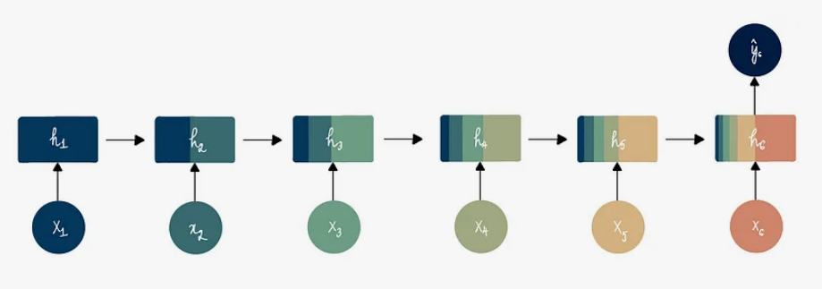

# Глава 2. LSTM и GRU как научить сеть помнить долго

Главное ограничение простой RNN — на длинных последовательностях она забывает то, что было в начале.



Простая RNN похожа на человека, который записывает каждое новое слово на одну и ту же страницу поверх старого текста. Через двадцать слов от первого почти ничего не остаётся.

## Long Short-Term Memory

LSTM (Long Short-Term Memory, «долгая краткосрочная память»)

Главная идея: отдельная линия памяти

В простой RNN есть только одно скрытое состояние h[t].
В LSTM появляется второе состояние — cell state, c[t] (состояние ячейки).

```text
Простая RNN:
    h[t-1] ──► [ h[t] ] ──► h[t]
                  ▲
                  │
                 x[t]

LSTM:
    c[t-1] ─────────────────────────► c[t]   ← «линия памяти»
                │           ▲
                │           │
    h[t-1] ──► [ h[t] ] ──► h[t]
                  ▲
                  │
                 x[t]

c[t] — это долговременная память. 
h[t] — это рабочая, «видимая наружу» память, которая передаётся дальше и используется для выхода.
```

Ключевое преимущество: c[t] обновляется аддитивно (по принципу сложения; общий результат — это сумма отдельных вкладов), а не через многократное умножение на матрицу.

В простой RNN $h[t] = f(W_{hh} \cdot h[t-1] + \dots)$, и градиент $\partial h[t] / \partial h[t-1]$ содержит матрицу $W_{hh}$.
При многократном умножении $(W_{hh})^{T-t}$ градиент затухает или взрывается.

В LSTM $c[t] = f[t] \odot c[t-1] + \dots$, и градиент $\partial c[t] / \partial c[t-1] = f[t]$ — это поэлементное умножение на вентиль, а не матрица.
Если $f \approx 1$, градиент проходит без изменений.
Это и есть «линия памяти»: градиент течёт по ней, не затухая.

LSTM управляет своей памятью с помощью трёх вентилей (gates).
Каждый вентиль — это слой с сигмоидой, который выдаёт числа от 0 до 1:
* 0 — «закрыто, не пропускать»;
* 1 — «открыто, пропускать всё».

```text
                    ┌──────────────┐
                    │  Forget gate │  f[t] = σ(...)
                    └──────┬───────┘
                           │ «что стереть из c[t-1]»
                           ▼
c[t-1] ────────────────► ⊗ ────────────────► ⊕ ────────────────► c[t]
                           ▲                   ▲
                    ┌──────┴───────┐   ┌───────┴────────┐
                    │  Input gate  │   │  Candidate     │
                    │  i[t] = σ(…) │   │  g[t] = tanh(…)│
                    └──────────────┘   └────────────────┘
                                               ▲
                                               │
h[t-1], x[t] ──────────────────────────────────┘

c[t] ──────────────────────────────────────► ⊗ ────────────────► h[t]
                                               ▲
                                      ┌────────┴────────┐
                                      │  Output gate    │
                                      │  o[t] = σ(…)    │
                                      └─────────────────┘
                                      
Forget gate f[t] — решает, какую часть старой памяти c[t-1] сохранить, а какую стереть.
Input gate i[t] — решает, какую часть новой кандидатной информации g[t] записать в память.
Output gate o[t] — решает, какую часть текущей памяти c[t] выдать наружу в h[t].                                      
```

Для шага t при входе x[t] и предыдущих состояниях h[t-1], c[t-1]:
```text
f[t] = σ( W_f · x[t] + U_f · h[t-1] + b_f )      // forget gate
i[t] = σ( W_i · x[t] + U_i · h[t-1] + b_i )      // input gate
g[t] = tanh( W_g · x[t] + U_g · h[t-1] + b_g )   // кандидат в память
o[t] = σ( W_o · x[t] + U_o · h[t-1] + b_o )      // output gate

c[t] = f[t] ⊙ c[t-1] + i[t] ⊙ g[t]               // обновление памяти
h[t] = o[t] ⊙ tanh(c[t])                         // выход / скрытое состояние

Где ⊙ — поэлементное умножение, σ — сигмоида.
```

Для обновления памяти нет умножения на матрицу весов.
Старая память умножается на вентиль f[t], новая информация добавляется.
Если $f[t] \approx 1$ и $i[t] \approx 0$, то $c[t] \approx c[t-1]$.

- Forget gate — решает, какие старые записи вычеркнуть, потому что они больше не нужны.
- Input gate — решает, какие новые факты стоит записать.
- Output gate — решает, какую часть конспекта показать сейчас (например, при ответе на вопрос).

Вентили — это обычные маленькие нейрослои со своими весами, и они обучаются тем же самым BPTT, что и всё остальное.

Откуда берётся градиент для вентиля
```text
c[t] = f[t] ⊙ c[t-1] + i[t] ⊙ g[t]

Значит, L зависит от f[t] через c[t] 
(на самом деле forget-вентиль влияет на память c, которая влияет на скрытое состояние h, из которого получается выход y, по которому считается потеря).
По цепному правилу: ∂L/∂f[t] = ∂L/∂c[t] ⊙ c[t-1]
То есть: «насколько потеря чувствительна к тому, что мы пропустили из старой памяти».

∂L/∂z_f[t] = ∂L/∂f[t] ⊙ σ'(z_f[t]) = ∂L/∂f[t] ⊙ f[t] ⊙ (1 - f[t])


1. Вентиль — это линейный слой + сигмоида, со своими W, U, b.
2. Эти параметры обучаются обычным BPTT вместе со всей сетью.
3. Градиент для вентиля приходит из будущего через состояние памяти (c или h).
4. Знак и величина градиента говорят вентилю:
      «в похожей ситуации откройся шире» / «прикройся сильнее».
5. Архитектура LSTM/GRU создаёт путь для градиента без матричного умножения,
   поэтому сигнал доходит до вентилей даже на длинных последовательностях.
6. Инициализация forget bias = 1 помогает этому пути работать с самого начала.
```

> $\partial L / \partial f[t] = \partial L / \partial c[t] \odot c[t-1]$
>
> Что это значит на практике? Если сеть ошиблась, потому что забыла важное ($c[t-1]$ было большим, а $f$ маленьким), то $\partial L / \partial f$ будет положительным (увеличение $f$ уменьшит ошибку).
> Градиентный шаг увеличит $f$ — вентиль «откроется шире» в похожей ситуации.
>
> Почему forget bias = 1? Потому что $\sigma(1) \approx 0.73$ — вентиль почти открыт.
> В начале обучения сеть ещё не знает, что забывать, и «открытый» forget gate позволяет градиенту течь через c без затухания.
> Если инициализировать $b_f = 0$, $\sigma(0) = 0.5$ — половина памяти теряется на каждом шаге, и градиент затухает быстрее. $b_f = 1$ — это «стартовый капитал» памяти.

Если сеть ошиблась, потому что запомнила лишнее ($c[t-1]$ было шумом, а $f$ большим), $\partial L / \partial f$ будет отрицательным, и $f$ уменьшится — вентиль «прикроется».

Простая RNN просто переписывает страницу заново каждый раз. LSTM умеет хранить, стирать и выдавать информацию выборочно.

Линия памяти (для LSTM):
```text
Пример: x = [7, 0, 0, 0, 0, 0], target = 7 (T=6)

Шаг 0 (запись):
  f[0] = σ(...) ≈ 0.5   (память пуста, нечего забывать)
  i[0] = σ(...) ≈ 1.0   (записываем!)
  g[0] = tanh(...) ≈ 7  (кандидат = x[0])
  c[0] = f[0]·c[-1] + i[0]·g[0] = 0.5·0 + 1.0·7 = 7
  o[0] = σ(...) ≈ 0.5   (наружу пока не нужно)
  h[0] = o[0]·tanh(c[0]) ≈ 0.5·tanh(7) ≈ 0.5

Шаг 1 (PAD, держим):
  f[1] = σ(...) ≈ 1.0   (ничего не забываем!)
  i[1] = σ(...) ≈ 0.0   (ничего не записываем!)
  g[1] = tanh(...) ≈ 0
  c[1] = 1.0·7 + 0.0·0 = 7   ← память не изменилась
  o[1] = σ(...) ≈ 0.5
  h[1] = 0.5·tanh(7) ≈ 0.5

Шаги 2..5 (PAD, держим):
  f[t] ≈ 1, i[t] ≈ 0  →  c[t] = c[t-1] = 7   ← память стоит на месте

Шаг 5 (выдача):
  o[5] = σ(...) ≈ 1.0   (пора выдать!)
  h[5] = 1.0·tanh(7) ≈ 1.0   ← в h[5] «виден» бит 7
  y[5] = softmax(W·h[5]) ≈ 7
```
- c[t] — это буквально линия памяти: на PAD-шагах она не меняется (если f=1, i=0).
- h[t] — это рабочая память: на PAD-шагах она может быть маленькой (o=0.5), но на последнем шаге o=1 «выдаёт» c[t] наружу.
- Вентили — это переключатели: f говорит «держать», i говорит «записывать», o говорит «выдавать».


## Gated Recurrent Unit

GRU (Gated Recurrent Unit) как упрощение LSTM. У GRU нет отдельного cell state c[t]. Есть только скрытое состояние h[t], но с двумя вентилями.

```text
                    ┌──────────────┐
                    │  Reset gate  │  r[t] = σ(...)
                    └──────┬───────┘
                           │ «что забыть из h[t-1]»
                           ▼
h[t-1] ────────────────► ⊗ ────────────────► tanh ────────────────► h'[t]
                                                                      │
                                                                      ▼
                    ┌──────────────┐                            ⊗ (1 - z[t])
                    │ Update gate  │  z[t] = σ(...)             │
                    └──────┬───────┘                            ▼
                           │ «сколько старого h[t-1] оставить»   ⊕ ────────► h[t]
                           └──────────────────────────────────► ⊗ z[t]
                                                                    ▲
                                                              h[t-1]
                                                              
Reset gate r[t] — решает, какую часть предыдущего состояния h[t-1] использовать при формировании кандидата h'[t]. Он управляет кратковременной памятью.
Update gate z[t] — решает, сколько старого состояния h[t-1] сохранить и сколько нового кандидата h'[t] взять. Он одновременно выполняет роль forget и input gate из LSTM.                                                              
```

```text
z[t] = σ( W_z · x[t] + U_z · h[t-1] + b_z )      // update gate
r[t] = σ( W_r · x[t] + U_r · h[t-1] + b_r )      // reset gate

h'[t] = tanh( W_h · x[t] + U_h · (r[t] ⊙ h[t-1]) + b_h )   // кандидат

h[t] = z[t] ⊙ h[t-1] + (1 - z[t]) ⊙ h'[t]        // обновление состояния
```

z[t] — это «смеситель» между старым и новым. Если $z[t] \approx 1$, состояние почти не меняется: $h[t] \approx h[t-1]$.

Линия памяти (для GRU)
```text
//В GRU нет отдельного c[t], но логика та же:

Шаг 0 (запись):
  z[0] = σ(...) ≈ 0.0   (обновляемся, старое не нужно)
  r[0] = σ(...) ≈ 1.0   (используем h[-1] = 0)
  h'[0] = tanh(...) ≈ 7
  h[0] = z[0]·h[-1] + (1-z[0])·h'[0] = 0·0 + 1·7 = 7

Шаг 1 (PAD, держим):
  z[1] = σ(...) ≈ 1.0   (обновление заблокировано!)
  h[1] = 1.0·h[0] + 0.0·h'[1] = 7   ← память стоит

Шаги 2..5 (PAD, держим):
  z[t] ≈ 1  →  h[t] = h[t-1] = 7   ← память стоит на месте

Шаг 5 (выдача):
  h[5] = 7   →  y[5] = softmax(W·h[5]) ≈ 7
```
- В GRU h[t] — это и есть линия памяти (отдельного c[t] нет).
- z[t] — это «смеситель»: z=1 — держать, z=0 — обновить.
- На PAD-шагах z ≈ 1, и h[t] не меняется — это и есть «память».

В литературе нет однозначного вывода, что лучше. GRU часто обучается быстрее, LSTM иногда точнее на сложных долгих зависимостях. На практике выбор часто зависит от задачи и ресурсов.

| Критерий | LSTM | GRU |
| --- | --- | --- |
| Параметров | Больше (4 набора весов) | Меньше (3 набора) |
| Скорость обучения | Медленнее | Быстрее |
| Длинные зависимости | Иногда точнее | Иногда хуже |
| Короткие последовательности | Избыточен | Достаточен |
| Когда выбирать | Сложные задачи, много данных | Быстрый прототип, мало данных |


## Зачем нужна маска

Рекуррентные слои (ElmanRnnLayer, GruLayer, BidirectionalLayer) в библиотеке требуют фиксированного seqLen.

Стандартный приём — padding: дополнить каждую последовательность до T_max специальным токеном PAD (обычно 0). Получаем тензор seq(T_max, dModel), где первые len токенов — настоящие, остальные T_max - len — PAD.

Это решает форму, но создаёт семантическую проблему: PAD — не токен языка, его не было в данных. Сеть не должна его учитывать. А RNN — учитывает: каждый шаг обновляет скрытое состояние.
h_t меняется — хотя настоящих данных не пришло.

Что делает маска [MaskingLayer](../../../../code/net/layers/mask/MaskingLayer.java)
```text
mask[t] = 1, если input[t] != PAD
mask[t] = 0, если input[t] == PAD

RNN, реализующий MaskConsumer, читает маску и пропускает PAD-шаги:

Прямой проход:
    если mask[t] == 0:
        h_t = h_{t-1}        // состояние не обновляется
    иначе:
        h_t = f(W_x·x_t + W_h·h_{t-1} + b)
        
Обратный проход:        
    если mask[t] == 0:
        dhPrev = dhCurr      // градиент проходит сквозь шаг
        // weightGrad, biasGrad, prevDelta НЕ накапливаются
    иначе:
        // обычный BPTT-шаг
```

PAD-шаг не обучает веса и не возвращает prevDelta во вход.

Таким образом мы «экономим» память RNN, не заставляя её выучивать PAD (пустые) символы.

Но есть и минус. Смотри задачу про палиндром ниже в этом же файле.

RNN с маской теряет сигнал длины. Без маски T - len (число PAD) — это прямая подсказка о длине, и RNN её использует. С маской h_{len-1} не зависит от len (ну, зависит, но неявно — через число шагов, которые RNN прошёл). А для палиндрома длина важна: чтобы проверить $t_i = t_{len-1-i}$, нужно знать len.

С маской RNN теряет подсказку о длине, а Elman RNN недостаточно силён, чтобы держать начало через 16 шагов. В итоге h_{len-1} — почти бесполезен для палиндрома, и сеть скатывается в p = 0.5.

Пример  
Строка [1, 2, 1] дополнена до T=5: [1, 2, 1, PAD, PAD].
Без маски RNN видит 5 шагов, и на шагах 4–5 h[t] меняется (хотя данных нет).
Это «случайное» изменение h[t] коррелирует с длиной: если PAD больше, h[T] «успевает» измениться сильнее.
Сеть может использовать это как неявную подсказку о длине.

С маской h[t] на PAD-шагах не меняется, и эта подсказка исчезает.
Для палиндрома это плохо: длина — ключевая информация, и RNN теряет её.

см разницу
```java
//rnn - если добавить маску, то будет хуже
    static Model buildRnn(boolean withMask) {
        List<Layer.Dto> dtos = new ArrayList<>();
        dtos.add(new Sequence.InputDto(TensorShape.flat(T_MAX)));
        if (withMask) dtos.add(new MaskingLayer.Dto(PAD));
        dtos.add(new EmbeddingLayer.Dto(VOCAB, D_MODEL));
        dtos.add(new ElmanRnnLayer.Dto(T_MAX, HIDDEN, new Tanh(), false));
        dtos.add(new DenseLayer.Dto(TensorShape.flat(1)));
        dtos.add(new ActivationLayer.Dto(new Sigmoid()));
        return Sequence.of(dtos);
    }

//rnn- с маской и добавленным пулингом. Будет только лучше    
static Model buildRnnWithMaskPooling() {
    List<Layer.Dto> dtos = List.of(
            new Sequence.InputDto(TensorShape.flat(T_MAX)),

            // 1. Маска: flat(T) → flat(T) + lastMask()
            new MaskingLayer.Dto(PAD),

            // 2. Embedding: flat(T) → seq(T, D_MODEL); маска идёт мимо
            new EmbeddingLayer.Dto(VOCAB, D_MODEL),

            // 3. ElmanRNN: returnSequences=true — отдаём всю последовательность
            new ElmanRnnLayer.Dto(T_MAX, HIDDEN, new Tanh(), /*returnSequences=*/ true),

            // 4. TokenPooling(MEAN): mean по настоящим токенам; выход flat(HIDDEN),
            //    маски больше нет (MaskKiller)
            new TokenPoolingLayer.Dto(TokenPoolingLayer.Mode.MEAN),

            new DenseLayer.Dto(TensorShape.flat(1)),
            new ActivationLayer.Dto(new Sigmoid())
    );
    return Sequence.of(dtos);
}    
```

TokenPoolingLayer - слой, который превращает последовательность векторов в один вектор: seq(T, d)  →  flat(d)

То есть T векторов длины d → один вектор длины d. Он «схлопывает» ось времени T. В библиотеке это заменяет связку SliceLayer(SEQ, T-1, 1) + ReshapeLayer — «взять последний токен и выпрямить».

| Режим | Формула | Что берёт |
| --- | --- | --- |
| LAST | $\text{out} = h[\text{last}]$ | Вектор последнего настоящего токена (mask[t] > 0) |
| MEAN | $\text{out} = \dfrac{1}{N} \sum_{t:\ \text{mask}[t]>0} h[t]$ | Среднее по настоящим токенам, N — их число (не T) |
| MAX | $\text{out}[d] = \max_{t:\ \text{mask}[t]>0} h[t][d]$ | Поэлементный максимум по настоящим токенам |

TokenPoolingLayer реализует MaskConsumer и читает mask. PAD-позиции (mask[t] == 0) исключаются из агрегации. Это не «усреднить всё и поделить на T» — это «усреднить только настоящие и поделить на их число».

Для MEAN: $\text{out} = (h[t_0] + h[t_1] + \dots + h[t_{N-1}]) / N$

TokenPooling(MEAN) даёт RNN доступ ко всем скрытым состояниям (включая начало), а не только к последнему, — и для палиндрома, где нужно сравнить оба конца, это решающе. Elman RNN без гейтов не может «донести» начало до h_{len-1}, но MEAN обходит это: начало уже в среднем, потому что h_0 — одно из слагаемых.


## Ближе к коду

### Задача нахождения палиндрома

Необходимо понять, является ли входная строка переменной длины палиндромом
```text
Примеры (target: 1=палиндром, 0=нет; длины разные):
  [0 3 3 1 0 2 2 0 1 3 3 0]       target=1
  [7 7 0 0 5 7]                   target=0
  [7 4 7 7 7 3 3 3 3 7 7 7 4 7]   target=1
  [2 1 2 2 4 6 0 4 4 0 6 4 4 2 1 2]  target=0
```

[Код - PalindromeExample](tasks/PalindromeExample.java)

Проблема переменной длины. RNN/GRU умеют работать только с фиксированным T (в текущей либе TensorShape.seq(seqLen, dModel) требует конкретного seqLen).

Решение: дополняем до T_max токеном `<PAD> = 0`, «настоящие» токены — 1..V-1.
- без маски модель учится (на данных) игнорировать PAD — это часть обучения, расходует ёмкость, и никогда не гарантировано;
- с маской модель не учится игнорировать PAD — она знает, где PAD, и пропускает его. Это гарантия на уровне архитектуры, а не результат обучения. PAD остаётся в данных, но PAD-шаги не влияют на h


Все модели — Sequence, то есть линейная цепочка. У них общий вход и общая голова, различается только «ядро» между ними:
```text
RNN(buildRnn(true)): 
InputDto            flat(16)
   │
   ▼
Embedding(10,16)    flat(16) → seq(16,16)
   │
   ▼
ElmanRNN(h=32)      seq(16,16) → flat(32)   [returnSequences=false]
   │
   ▼
Dense(1)            flat(32) → flat(1)
   │
   ▼
Sigmoid             flat(1) → flat(1)
   │
   ▼
target [0|1]

RNN с маской (buildRnnWithMaskPooling)
InputDto            flat(16)
   │
   ▼
MaskingLayer(PAD=0) flat(16) + mask[16]
   │
   ▼
Embedding(10,16)    flat(16) → seq(16,16)
   │
   ▼
ElmanRNN(h=32)      seq(16,16) → seq(16,32)   [returnSequences=TRUE]
   │
   ▼
TokenPooling(MEAN)  seq(16,32) → flat(32)     [mean по настоящим токенам,
   │                                            mask → null (MaskKiller)]
   ▼
Dense(1)            flat(32) → flat(1)
   │
   ▼
Sigmoid             flat(1) → flat(1)
   │
   ▼
target [0|1]

GRU
InputDto            flat(16)
   │
   ▼
Embedding(10,16)    flat(16) → seq(16,16)
   │
   ▼
GRU(h=32)           seq(16,16) → flat(32)   [returnSequences=false]
   │
   ▼
Dense(1)            flat(32) → flat(1)
   │
   ▼
Sigmoid             flat(1) → flat(1)
   │
   ▼
target [0|1]

BiRnn
InputDto            flat(16)
   │
   ▼
Embedding(10,16)    flat(16) → seq(16,16)
   │
   ▼
BidirectionalLayer  seq(16,16) → flat(64)   [returnSequences=false,
   (Elman, h=32)                              cell = ElmanRnnLayer.Dto(...)]
   │
   ▼
Dense(1)            flat(64) → flat(1)
   │
   ▼
Sigmoid             flat(1) → flat(1)
   │
   ▼
target [0|1]
```

Embedding — это «one-hot + Dense» без лишних умножений.
Превращает индексы в векторы и обучается вместе со всем.

На T_MAX = 16, VOCAB = 10, 4000 train-примеров, 30 эпох, AdamW(lr=3e-3), clipNorm=1.0:

| Модель | Без маски | С маской | Δ | Комментарий |
| --- | --- | --- | --- | --- |
| RNN | 0.69–0.80 | 0.51 | −0.19…−0.28 | Elman RNN не держит начало через 16 шагов; маска обнажает это (антипример). |
| RNN + pooling | — | 0.68 | — | returnSequences=true + TokenPooling(MEAN) — «правильный» способ, но Elman RNN слишком слаб. |
| BiRNN | 0.89 | 0.92 | +0.04 | Маска убирает PAD с конца обратного направления. |
| GRU | 0.88 | 0.91 | +0.03 | Гейты сохраняют начало, маска убирает PAD-шаги. |
| BiGRU | 0.94 | 0.98 | +0.04 | Лучшее из четырёх. Маска + гейты + оба направления. |


Маска стабильно помогает BiRNN/GRU/BiGRU (+0.03…+0.04). Для Elman RNN она обнажает ограничение архитектуры (−0.19…−0.28), и «починить» это можно только pooling'ом или заменой на GRU/BiRNN.


Также важный момент: RNN использует tanh как функцию активации (с LeakyRelu вообще не сошлось), а BiRnn — два слоя RNN с LeakyRelu-активацией.
Пожалуй, если поставить tanh в BiRnn, то она догонит, а то и обгонит GRU, хотя, конечно, проиграет BiGRU.

Tanh — стандарт для ElmanRNN, центрированный выход помогает против затухания (см. сноску в начале документа).

Но если увеличить длину последовательности, то RNN всё равно рано или поздно «затухнет» и не справится.
BiRNN будет держаться вдвое дольше.
Ну а GRU — как раз специализируется на долговременной памяти.

как вентили «учатся»
```text
Пример: сеть видит [1, 2, 1] (палиндром), но предсказывает 0.5.
Почему? Потому что forget gate «забыл» первую 1 к моменту, когда дошёл до последней.

Градиент по f:
  ∂L/∂f[1] = ∂L/∂c[1] ⊙ c[0]
  c[0] = 0 (начальное состояние), поэтому ∂L/∂f[1] = 0 — первый шаг не важен.
  
  ∂L/∂f[2] = ∂L/∂c[2] ⊙ c[1]
  c[1] — это «память о первой 1». Если f[2] было маленьким, c[2] потеряло первую 1.
  ∂L/∂c[2] положительно (ошибка), c[1] положительно → ∂L/∂f[2] > 0.
  Градиентный шаг увеличит f[2] — вентиль «откроется шире» на следующей итерации.
```

### Задача Long-Range Copy (копирование с задержкой)

Есть последовательность длины T. В самом начале, на шаге 0, подаётся один сигнал. Все остальные шаги — нули (шум).

Это чистая проверка долговременной памяти. Сеть должна «донести» один бит информации через T шагов и выдать его в конце.

```text
Примеры (сеть должна вернуть первый токен):
  [0 3 3 1 0 2 5 7 5 0 1 7 1 7 4 7 7 7 3 3 7 2 1 2 2 4 6 0 4 6 4]  target=0
  [6 1 3 3 7 1 4 7 3 0 2 4 0 5 1 0 7 5 4 7 7 1 2 2 2 3 7]  target=6
  [2 3 0 4 1 7 5 5 2 7 2 4 2 3 0 3 1 2 4 5 3 7 0 1 2 1 1]  target=2
```

```text
Input(flat(T)) → Embedding(V, dModel) → [RNN/GRU/BiRNN] → Dense(V) → (Softmax в loss)
```

Почему Tanh, а не LeakyRelu в RNN.

На T = 50 LeakyRelu в рекуррентном слое почти гарантированно «взорвётся» или «затухнет»: $h_t = \text{LeakyRelu}(W_h \cdot h_{t-1} + \dots)$, и при $|\lambda(W_h)| > 1$ состояние растёт экспоненциально.
Tanh ограничен (-1, 1) — стандарт для RNN. Это ровно та проблема, из-за которой ваш предыдущий прогон на палиндроме сидел на ln(2).


Почему T = 50

- Меньше 20 — ElmanRNN ещё справляется, разница между архитектурами не видна.
- Больше 100 — GRU/BiRNN тоже начнут «сдаваться», обучение станет долгим.

50 — «золотая середина»: RNN «сломан», GRU и BiRNN — работают.

[LongRangeCopyExample](tasks/LongRangeCopyExample.java)

```terminaloutput
19:20:54.808 [main] INFO rawnet.docs.flows.main.rnn.tasks.LongRangeCopyExample -- Sequence (30,1,1) → (10,1,1)

19:20:54.807 [main] INFO rawnet.docs.flows.main.rnn.tasks.LongRangeCopyExample -- === RNN ===
19:21:13.579 [main] INFO rawnet.code.sequence.model.net.Sequence -- Эпоха обучения 29. Метрики Метрики: Loss(SoftmaxCrossEntropy)=1.6124  Accuracy=0.4750  

19:21:13.582 [main] INFO rawnet.docs.flows.main.rnn.tasks.LongRangeCopyExample -- === GRU ===
19:21:54.722 [main] INFO rawnet.code.sequence.model.net.Sequence -- Эпоха обучения 29. Метрики Метрики: Loss(SoftmaxCrossEntropy)=0.0037  Accuracy=1.0000

19:21:54.739 [main] INFO rawnet.docs.flows.main.rnn.tasks.LongRangeCopyExample -- === BiRNN ===  
19:22:32.687 [main] INFO rawnet.code.sequence.model.net.Sequence -- Эпоха обучения 29. Метрики Метрики: Loss(SoftmaxCrossEntropy)=0.0003  Accuracy=1.0000 
```

Как видим: RNN частично справляется на последовательности длиной 30 шагов. GRU и BiRnn справляются отлично.

Если поднять длину последовательности до 50 шагов, то GRU перестанет справляться.
Любопытно, что при этом BiRnn всё равно справляется.
Но это логично, так как она читает последовательность в двух направлениях.
Обратный проход видит x_0 последним, и ему не нужно «тащить» его через 50 шагов: он видит его на шаге 0 (в обратном направлении).

Почему 50?
GRU «держит» информацию через гейты, но гейты — это $\sigma$, и $\sigma$ насыщается.
На каждом шаге $h[t] = z \odot h[t-1] + \dots$, и если $z \approx 0.98$, через 50 шагов $0.98^{50} \approx 0.36$ — информация ещё видна.
Если $z \approx 0.95$, $0.95^{50} \approx 0.08$ — почти потеряна.
На 50 шагах GRU «балансирует на грани»: иногда z достаточно близко к 1, иногда нет. BiRNN обходит это, «деля» путь надвое.

Как обучать GRU, чтобы она всё-таки справлялась на 50?
Поэтапно. T = 5 → 10 → 20 → 50. Это называется «циклическое обучение (curriculum learning)».
>Почему это работает? На T=5 GRU быстро учится «держать» информацию. Веса гейтов настраиваются так, чтобы $z \approx 1$ на коротких последовательностях. Когда T увеличивается до 10, GRU стартует с уже «правильных» весов, и ему нужно лишь немного подстроиться. Если сразу дать T=50, GRU стартует со случайных весов, и градиент затухает до того, как гейты научатся «держать»

Что должна выучить сеть на Long-Range Copy?
- На шаге 0 — записать бит: i ≈ 1, f ≈ 0.5 (память пуста).
- На шагах 1..T-1 — держать: f ≈ 1, i ≈ 0.
- На шаге T — выдать: o ≈ 1.

Если сеть выучила это, c[t] на PAD-шагах не меняется, и бит «доезжает» до конца. \
Если f меньше 1 (например, 0.9), бит затухает: через 50 шагов $0.9^{50} \approx 0.005$ — сеть «забыла».

Именно поэтому GRU (с гейтами) справляется на T=30, а простая RNN — нет: у RNN нет f, и h[t] каждый шаг умножается на $W_{hh}$, что и даёт затухание.

### Задача отложенного сложения

Вход: две параллельные дорожки длины T=50:
- дорожка значений: случайные числа в [0, 1);
- дорожка маркеров: 50 нулей, но ровно два маркера = 1.

Выход (scalar): сумма значений в позициях, отмеченных маркерами.

```text
t:        0     1     2     3   ...   m1   ...  m2   ...  49
values:  .21   .73   .55   .08  ...  .42  ...  .88  ...  .31
markers:  0     0     0     0   ...   1   ...   1   ...   0
                                 (m2-m1 может быть 49 шагов)

target = 0.42 + 0.88 = 1.30
```
```text
Примеры (T=50, target = v[m1] + v[m2]):
  m1= 2 (v=0,410)   m2=33 (v=0,042)   |m2-m1|=31   target=0,452
  m1=25 (v=0,846)   m2=44 (v=0,984)   |m2-m1|=19   target=1,830
  m1= 1 (v=0,291)   m2=25 (v=0,359)   |m2-m1|=24   target=0,650
  m1=17 (v=0,055)   m2=32 (v=0,100)   |m2-m1|=15   target=0,155
```

[DelayedSummationExample](tasks/DelayedSummationExample.java)

Тонкость про Embedding. В предыдущих задачах вход был индексами токенов (целые числа), и EmbeddingLayer превращал их в векторы. Здесь вход — вещественные числа (values[t] ∈ [0, 1), markers[t] ∈ {0,1}).
EmbeddingLayer не подходит — он ожидает целые индексы и упадёт на 0.42.

Заменим Embedding-слой на Reshape → TimeDistributedDense(→ dModel) → RNN. Это даёт сети «входную проекцию» (аналог Embedding для вещественных признаков), и RNN работает с dModel-мерными векторами.
```text
Input(flat(100)) → Reshape(seq(50, 2)) → TimeDistributedDense(16) → RNN/GRU/BiRNN → Dense(1) → Linear
```

```java
    static Model buildGru() {
        List<Layer.Dto> dtos = List.of(
                new Sequence.InputDto(TensorShape.flat(2 * T)),
                new ReshapeLayer.Dto(TensorShape.seq(T, 2)),
                new TimeDistributedDenseLayer.Dto(D_MODEL),
                new GruLayer.Dto(T, HIDDEN, false),
                new DenseLayer.Dto(TensorShape.flat(1)),
                new ActivationLayer.Dto(new Linear())
        );
        return Sequence.of(dtos);
    }
```

Чередование [v0, m0, v1, m1, …], а не конкатенация [v0, …, v49, m0, …, m49]. При чередовании seq(T, 2) даёт пару (v[t], m[t]) на каждом шаге — RNN видит их одновременно, что естественно для «отложенного сложения». При конкатенации Reshape(seq(2, T)) дал бы две «строки» — пришлось бы обрабатывать отдельно. Чередование проще и семантичнее.

Почему Tanh для RNN, а не LeakyRelu. Как и в long-range copy: LeakyRelu в рекуррентном слое «взрывается» на T = 50. Tanh ограничен (-1, 1).

Почему Mse + Linear, а не Mse + Sigmoid.
Mse.derivative даёт $p - t$ — с Linear это ровно $\partial L / \partial z$ (производная Linear = 1).
С Sigmoid градиент $(p - t) \cdot p(1-p)$ исчезает, когда $p \approx 0$ или $p \approx 1$ (насыщение). Если сеть уверена, но ошибается (p = 0.99, t = 0), градиент $(0.99 - 0) \cdot 0.99 \cdot 0.01 \approx 0.0098$ — почти ноль. С Linear градиент $p - t = 0.99$ — большой.
Linear + Mse не насыщается, и сеть «исправляет» ошибку быстрее. Поэтому является стандартом для регрессии.


[DelayedSummationExample](tasks/DelayedSummationExample.java)

```terminaloutput
19:56:23.959 [main] INFO rawnet.docs.flows.main.rnn.tasks.DelayedSummationExample -- Sequence (100,1,1) → (1,1,1)

19:56:23.959 [main] INFO rawnet.docs.flows.main.rnn.tasks.DelayedSummationExample -- === RNN ===
19:56:49.623 [main] INFO rawnet.code.sequence.model.net.Sequence -- Эпоха обучения 29. Метрики Метрики: Loss(Mse)=0.0117  RMSE=0.1080  
19:56:49.625 [main] INFO rawnet.code.sequence.model.net.Sequence -- ответ сети [0.74]  (правильный ответ = [0.77])
19:56:49.625 [main] INFO rawnet.code.sequence.model.net.Sequence -- ответ сети [1.33]  (правильный ответ = [1.58])
19:56:49.625 [main] INFO rawnet.code.sequence.model.net.Sequence -- ответ сети [0.45]  (правильный ответ = [0.39])

19:56:49.626 [main] INFO rawnet.docs.flows.main.rnn.tasks.DelayedSummationExample -- === GRU ===
19:57:47.935 [main] INFO rawnet.code.sequence.model.net.Sequence -- Эпоха обучения 29. Метрики Метрики: Loss(Mse)=0.0003  RMSE=0.0160  
19:57:47.936 [main] INFO rawnet.code.sequence.model.net.Sequence -- ответ сети [0.76]  (правильный ответ = [0.77])
19:57:47.936 [main] INFO rawnet.code.sequence.model.net.Sequence -- ответ сети [1.56]  (правильный ответ = [1.58])
19:57:47.937 [main] INFO rawnet.code.sequence.model.net.Sequence -- ответ сети [0.39]  (правильный ответ = [0.39])

19:57:47.944 [main] INFO rawnet.docs.flows.main.rnn.tasks.DelayedSummationExample -- === BiRNN ===
19:58:44.150 [main] INFO rawnet.code.sequence.model.net.Sequence -- Эпоха обучения 29. Метрики Метрики: Loss(Mse)=0.0347  RMSE=0.1864  
19:58:44.151 [main] INFO rawnet.code.sequence.model.net.Sequence -- ответ сети [0.79]  (правильный ответ = [0.77])
19:58:44.151 [main] INFO rawnet.code.sequence.model.net.Sequence -- ответ сети [1.38]  (правильный ответ = [1.58])
19:58:44.151 [main] INFO rawnet.code.sequence.model.net.Sequence -- ответ сети [0.52]  (правильный ответ = [0.39])
```

Видим, что RNN довольно неплохо справилась. Хотя, конечно, хуже чем GRU.

Почему GRU идеален для delayed summation.
Гейты — это «переключатель»: z_t говорит «обновлять или нет», r_t — «сбрасывать или нет».
Для задачи «ждать маркер, запомнить значение, дождаться второго, сложить» это естественная операция.
RNN «не умеет ждать» — он обновляет h на каждом шаге, и шум «размывает» память.

Для delayed summation важен порядок: сначала m1, потом m2.
Прямой проход видит m1 раньше m2 — это естественно.
Обратный проход видит m2 раньше m1 — это противоречит порядку задачи.
Сеть «путается»: прямой говорит «сначала m1», обратный — «сначала m2».
Конкатенация этих сигналов не помогает, а мешает: GRU с одним направлением «знает» порядок, BiRNN — «сомневается».

| Модель | RMSE | Урок |
| --- | --- | --- |
| GRU | 0.016 | «Гейты — идеальный инструмент для delayed summation»: update gate «замораживает» h на шуме, reset gate «сбрасывает» перед маркером. m2 - m1 ~ 16 — гейты справляются. |
| RNN | 0.108 | «Vanishing gradient»: без гейтов v[m1] «размывается» на пути к m2. Сеть выдаёт «среднее», а не точную сумму. |
| BiRNN | 0.186 | «BiRNN — не панацея»: для copy first обратное чтение видит x_0 последним, для delayed summation — m1 последним (плохо), m2 первым (хорошо). Симметрия теряется, и BiRNN хуже GRU на этой задаче. |